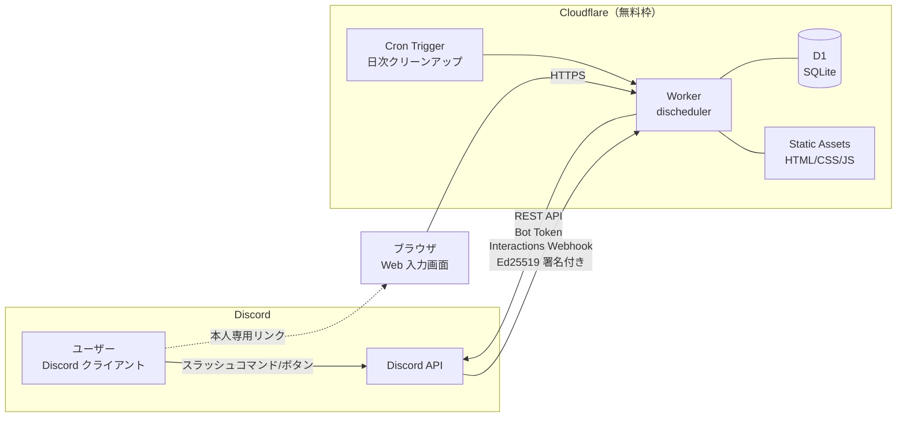
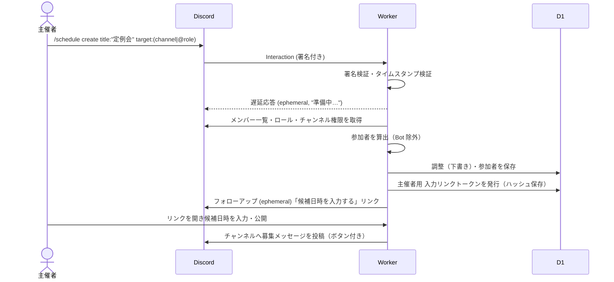
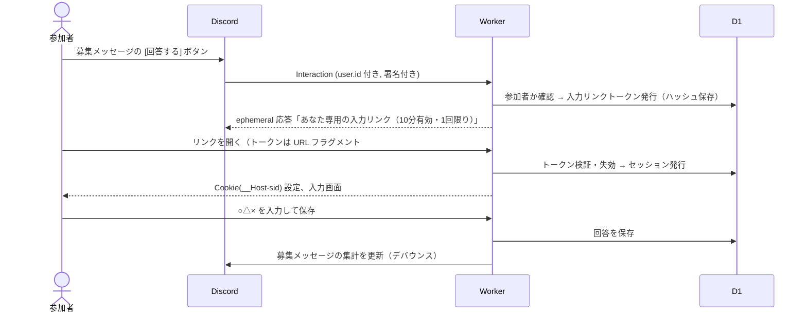
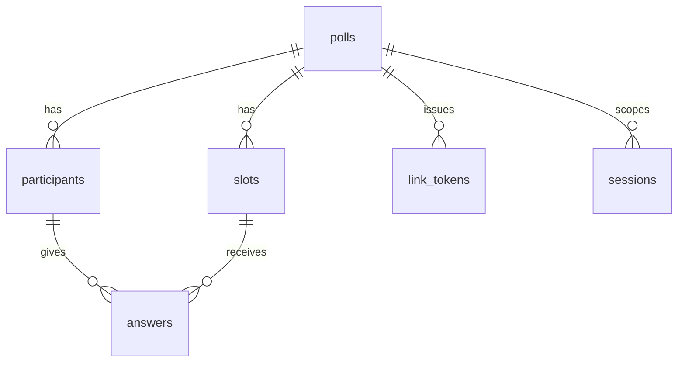

# DIscheduler 設計書

Discord のチャンネル（またはロール）のメンバー間で日程調整を行う Bot / Web アプリケーション。
Cloudflare Workers の無料枠のみで完結するサーバーレス構成とする。

- 版: 0.2
- 作成日: 2026-11-04
- 改訂: 2026-11-05（未決事項を確定: 保持期間 6 ヶ月、参加者抽出モード選択式、回答全員公開、作成権限、タイムゾーン設定）
- 関連文書: [SECURITY.md](../SECURITY.md)（公開セキュリティ方針）、[docs/security-design.md](./security-design.md)（セキュリティ設計詳細）

---

## 1. 目的とスコープ

### 1.1 目的
Discord 上の集まり（ゲーム会・勉強会・オフ会など）の日程調整を、外部サービス（調整さん等）へのアカウント登録や URL 共有なしに、Discord 内から開始・回答・確定まで行えるようにする。

### 1.2 要件と対応方針

| # | 要件 | 対応方針 | 実現性 |
|---|------|----------|--------|
| R1 | チャンネルメンバー／ロールメンバーが参加者として初期表示される | 作成時に Discord REST API でギルドメンバーを取得し、チャンネル閲覧権限またはロール所持で絞り込んで参加者リストを生成 | ◎（標準は Server Members Intent による自動抽出。手動選択も選べる。§5.3） |
| R2 | 主催者が簡単に候補日時を入力できる（HTML） | Workers Static Assets で配信する Web 画面。カレンダーで日付を複数選択 → 時間帯を一括適用 | ◎ |
| R3 | メンバーが簡単に予定を入力できる | Discord のボタン → 本人専用リンク（ログイン不要）→ ○△× をタップするだけの Web 画面 | ◎ |
| R4 | 入力方法がわかりやすく、候補日時が見やすい | 表形式（候補×メンバー）＋集計＋最有力候補のハイライト。スマホ優先レイアウト | ◎ |
| R5 | 確定日時を Discord イベントとして登録 | Guild Scheduled Event API で作成（Bot に「イベントの作成」権限が必要） | ◯（任意機能。権限がなければスキップ） |
| R6 | Cloudflare Workers でサーバーレス完結・維持費ゼロ | Workers Free + D1 Free + Static Assets + Cron Triggers のみ使用 | ◎（§9 で無料枠試算） |
| R7 | セキュリティ対策を徹底し、対策内容を公開 | 署名検証・最小権限・データ最小化・CSP 等を実装し、`SECURITY.md` と `/security` ページで公開 | ◎ |

### 1.3 スコープ外（初版）
- 繰り返し予定、外部カレンダー（Google/Outlook）連携
- 複数ギルドをまたいだ調整
- ネイティブアプリ

---

## 2. 用語

| 用語 | 意味 |
|------|------|
| 調整（Poll） | 1 件の日程調整。タイトル・候補日時・参加者・回答を持つ |
| 主催者（Organizer） | 調整を作成したユーザー。候補編集・確定・削除ができる |
| 参加者（Participant） | 回答を求められるユーザー。作成時に自動抽出され、主催者が増減できる |
| 候補（Slot） | 候補日時 1 件（開始・終了） |
| 回答（Answer） | 参加者×候補 の ○（参加可）／△（未定・条件付き）／×（不可） |
| 入力リンク | 参加者本人だけに一時表示される、短命・使い捨ての Web 画面用リンク |

---

## 3. システム構成

### 3.1 全体構成図



### 3.2 採用技術

| 区分 | 技術 | 理由 |
|------|------|------|
| 実行環境 | Cloudflare Workers（Free） | 常駐プロセス不要。HTTP Interactions 方式なら Gateway 接続が不要 |
| Discord 連携 | HTTP Interactions Endpoint + REST API | WebSocket 常駐が不要でサーバーレスと相性が良い |
| DB | Cloudflare D1（Free） | SQL・トランザクション・プリペアドステートメントが使える。書込上限が KV より大きい |
| 静的配信 | Workers Static Assets | 無料・同一オリジンで配信でき CSP を厳しくできる |
| 定期処理 | Cron Triggers | 期限切れデータの自動削除 |
| 言語 | TypeScript | 型による入力検証の取りこぼし防止 |
| ルーティング | Hono | Workers ネイティブで軽量、依存が少ない |
| 入力検証 | Valibot | 軽量なスキーマ検証 |
| フロントエンド | 素の TypeScript（フレームワークなし）＋ Vite でビルド | 依存最小化・バンドル軽量化・サプライチェーンリスク低減 |
| CI | GitHub Actions | テスト・型検査・依存監査・CodeQL・デプロイ |

> 依存パッケージは「ランタイム依存は Hono と Valibot のみ」を原則とし、追加時はレビュー必須とする（§security-design 参照）。

### 3.3 Gateway を使わない理由
Discord Bot は通常 WebSocket（Gateway）に常時接続するが、Workers は常駐できない。本アプリはスラッシュコマンド・ボタン・モーダルのみで操作する設計とし、すべて HTTP の Interactions Webhook で受け取る。メンバー情報などは必要な時に REST API で取得する。

---

## 4. 利用フロー

### 4.1 調整の作成（主催者）



1. 主催者がスラッシュコマンド `/schedule create` を実行。オプション:
   - `title`（必須, 最大 100 文字）
   - `members`（任意, 選択式）: 参加者の決め方
     - `auto`（既定）: Server Members Intent で自動抽出。`role` 指定時はそのロールのメンバー、未指定ならコマンドを実行したチャンネルを閲覧できるメンバー
     - `manual`: 主催者が Web 画面で参加者を選ぶ（自動抽出なし）
   - `role`（任意）: 指定するとそのロールのメンバーが参加者
   - `deadline`（任意）: 回答締切（既定 7 日後）
2. Worker は 3 秒以内に「遅延応答（ephemeral）」を返し、メンバー取得等は `ctx.waitUntil` で継続する。
3. 主催者だけに見えるメッセージで「候補日時を入力する」リンクを返す。
4. Web 画面で候補日時を入力し「公開」すると、チャンネルに募集メッセージ（埋め込み＋ボタン）が投稿される。

### 4.2 回答（参加者）



- 参加者は Discord ボタンを押すだけで本人確認済みの入力画面に入れる（Discord アカウントでの追加ログイン不要）。
- 簡易回答として、Discord 上の [全部○] [全部×] のようなショートカットは提供しない（誤操作防止）。代わりに Web 画面に「すべて○にする」ボタンを置く。

### 4.3 確定（主催者）

1. 主催者が Web 画面の集計表で候補を選び「この日時で確定」。
2. オプションで「Discord イベントとして登録」にチェック（場所: ボイスチャンネル選択 or 自由入力）。
3. Worker が
   - 調整のステータスを `fixed` に更新
   - 募集メッセージを「確定: <t:UNIX:F>」に編集し、参加者へメンション付きでお知らせを投稿（メンション有無は選択可）
   - Guild Scheduled Event を作成（権限がなければスキップし、その旨を主催者に表示）

### 4.4 その他のコマンド

| コマンド | 内容 | 実行者 |
|----------|------|--------|
| `/schedule create` | 調整を作成（実行者が主催者になる） | コマンドを実行した人なら誰でも（§5.4） |
| `/schedule list` | このチャンネルの進行中の調整一覧（ephemeral） | 誰でも |
| `/schedule manage` | 自分が主催する調整の管理リンクを再発行（ephemeral） | 主催者 |
| `/schedule help` | 使い方とセキュリティ方針へのリンク | 誰でも |

---

## 5. Discord 連携詳細

### 5.1 Bot の登録
- インストールスコープ: `bot`, `applications.commands`（ギルドインストールのみ。ユーザーインストールは無効）
- Interactions Endpoint URL: `https://<worker-domain>/discord/interactions`
- コマンドはデプロイスクリプトから REST API（`PUT /applications/{id}/commands`）で登録

### 5.2 必要な Bot 権限（最小権限）

| 権限 | 用途 | 必須 |
|------|------|------|
| View Channels | 投稿先チャンネルの参照 | 必須 |
| Send Messages | 募集・確定メッセージの投稿 | 必須 |
| Embed Links | 埋め込み表示 | 必須 |
| Create Events | 確定日時の Discord イベント作成 | 任意（R5 を使う場合） |
| Manage Events | Bot が作成したイベントの編集・削除 | 任意 |

> **Administrator 権限は要求しない。** メッセージ内容（Message Content Intent）も不要のため要求しない。

### 5.3 参加者の決定（R1）

参加者の決め方は **選択式** とし、調整ごとに `/schedule create` の `members` オプション（および S2 画面）で選ぶ。

| モード | 既定 | 内容 | 必要な設定 |
|--------|------|------|------------|
| `auto` | ◎ | チャンネル閲覧者またはロール所持者を自動抽出（下記手順） | Server Members Intent |
| `manual` | | 主催者が S2 画面でサーバーメンバーを検索・選択（`GET /guilds/{id}/members/search` を使用）、または User Select Menu で選択 | 不要 |

どちらのモードでも、自動抽出後に主催者が S2 画面で参加者を追加・削除できる。
Server Members Intent が無効のまま `auto` が選ばれた場合（API が 403 を返す）は、`manual` に自動で切り替えて主催者にその旨を表示する。

#### 自動抽出（`auto`）の手順

Discord には「チャンネルのメンバー一覧」API がないため、次の手順で算出する。

1. `GET /guilds/{guild_id}/members?limit=1000&after=…` でギルドメンバーを取得（ページング）
   - **Server Members Intent（特権インテント）を Developer Portal で有効化する必要がある**
2. 対象の決定
   - **ロール指定時**: `member.roles` に対象ロール ID を含むメンバー
   - **チャンネル指定時**: `GET /guilds/{id}/roles` と `GET /channels/{id}` の権限上書き（permission_overwrites）から、Discord 公式の権限計算アルゴリズムで `VIEW_CHANNEL` を持つメンバーを算出（スレッドの場合は親チャンネル、プライベートスレッドの場合は `GET /channels/{id}/thread-members`）
3. Bot アカウント（`user.bot = true`）を除外
4. 上限: 参加者 100 名（表の見やすさと Workers Free の CPU 時間 10ms を考慮）。超える場合はロール指定を案内

参加者以外が [回答する] を押した場合の挙動は調整ごとに選択:
- `closed`（既定）: 「この調整の参加者ではありません」と ephemeral で返す
- `open`: 参加者として追加して回答可能にする

### 5.4 作成権限
- **`/schedule` コマンドを実行できた人は誰でも調整を作成でき、実行者がその調整の主催者になる。** アプリ側で作成者のロール等による追加制限は行わない。
- スラッシュコマンドの `default_member_permissions` は未設定（全員可）。サーバー管理者が制限したい場合は、Discord 標準の「サーバー設定 → 連携サービス」でコマンドを実行できるロール／チャンネルを絞れる（アプリの変更は不要）。
- 乱用防止として作成数のレート制限（10 件/時/ユーザー）のみ設ける（security-design D-2）。
- アプリ側でも「主催者本人のみ」が編集・確定・削除できるよう認可チェックを行う（§security-design）。

### 5.5 募集メッセージの更新
- Interaction トークンは 15 分で失効するため、募集メッセージは **Bot トークンで投稿し**、`channel_id` と `message_id` を保存して `PATCH /channels/{id}/messages/{id}` で更新する。
- 回答保存のたびに更新すると API レート制限に触れるため、最終更新から 30 秒以内の更新はスキップし、Cron（または次回の回答時）で追いつかせる。
- メッセージには候補ごとの ○ 人数と回答率のみを表示し、**誰が×かなど個人の回答はチャンネルに表示しない**（Web 画面で参加者のみ閲覧可）。

### 5.6 Discord イベント登録（R5）
`POST /guilds/{guild_id}/scheduled-events`

| フィールド | 値 |
|------------|----|
| `name` | 調整タイトル |
| `scheduled_start_time` / `scheduled_end_time` | 確定候補の開始・終了（ISO8601） |
| `entity_type` | `2`（VOICE）または `3`（EXTERNAL） |
| `channel_id` | VOICE の場合のボイスチャンネル |
| `entity_metadata.location` | EXTERNAL の場合の場所（最大 100 文字） |
| `privacy_level` | `2`（GUILD_ONLY） |
| `description` | 調整の説明（任意） |

失敗時（権限不足・過去日時など）は確定処理自体は成功させ、主催者にエラー理由を表示する。

---

## 6. Web 画面設計

### 6.1 共通方針
- スマートフォン（Discord アプリ内ブラウザ）での操作を最優先。最小タップ領域 44px。
- 日本語 UI。日時の表示・入力は §6.7 のタイムゾーン規則に従う（例: `11/12(水) 20:00–22:00 JST`）。
- ライト／ダークモード対応（Discord の利用者はダークが多い）。
- 外部 CDN・外部フォント・解析タグは一切読み込まない（CSP で禁止）。
- 色だけに頼らない（○△× は記号＋色＋読み上げラベル）。

### 6.2 画面一覧

| ID | 画面 | URL | 利用者 |
|----|------|-----|--------|
| S1 | リンク検証（中継） | `/l#<token>` | 全員 |
| S2 | 候補日時入力 | `/p/{pollId}/edit` | 主催者 |
| S3 | 回答入力 | `/p/{pollId}/answer` | 参加者 |
| S4 | 集計・確定 | `/p/{pollId}` | 参加者（全員が全員の ○△× を閲覧可。確定操作は主催者のみ） |
| S5 | エラー（期限切れ等） | — | 全員 |
| S6 | セキュリティ方針 | `/security` | 公開 |

### 6.3 S2: 候補日時入力（主催者）

```
┌──────────────────────────────────┐
│ 定例会  の候補日時                │
├──────────────────────────────────┤
│ ① 日付をタップして選択（複数可）   │
│   ◀ 2026年11月 ▶                  │
│   日 月 火 水 木 金 土             │
│          [4] 5  6  7  8           │
│    9 10 [11][12] 13 14 15  ...     │
├──────────────────────────────────┤
│ ② 時間帯                          │
│   よく使う: [昼 12-13] [夜 20-22]  │
│   開始 [20:00▼] 終了 [22:00▼]      │
│   [＋ 選択中の日付に追加]          │
├──────────────────────────────────┤
│ ③ 候補一覧 (3件)                  │
│   11/4(水) 20:00–22:00     [×]    │
│   11/11(水) 20:00–22:00    [×]    │
│   11/12(木) 20:00–22:00    [×]    │
├──────────────────────────────────┤
│ 参加者 (12名) [編集]              │
│ 締切 11/11(水) 23:59 [変更]        │
│        [ 公開してチャンネルに投稿 ] │
└──────────────────────────────────┘
```

- 日付の複数選択 × 時間帯の一括適用で、10 候補でも数タップで作成可能。
- 「終日」チェックで時間なし候補も可。
- 候補上限 30 件。
- 公開後も候補の追加は可能（削除は回答済みの場合に確認ダイアログ）。

### 6.4 S3: 回答入力（参加者）

```
┌──────────────────────────────────┐
│ 定例会   締切 11/11(水) 23:59     │
│ あなた: @yuka                     │
├──────────────────────────────────┤
│ 11/4(水) 20:00–22:00              │
│   [ ○ 参加 ] [ △ 未定 ] [ × 不可 ] │
│ 11/11(水) 20:00–22:00             │
│   [ ○ 参加 ] [ △ 未定 ] [ × 不可 ] │
│ 11/12(木) 20:00–22:00             │
│   [ ○ 参加 ] [ △ 未定 ] [ × 不可 ] │
├──────────────────────────────────┤
│ [すべて○] [すべて×]               │
│ ひとこと（任意, 100字）[        ]  │
│               [ 保存する ]         │
└──────────────────────────────────┘
```

- 1 候補 1 行のセグメントボタン（ラジオボタン）。未回答は灰色。
- 保存後は S4（集計）へ遷移し、自分の行がハイライトされる。
- 締切後は閲覧のみ。

### 6.5 S4: 集計・確定

```
┌────────────────────────────────────────────┐
│ 定例会   回答 9/12 名                        │
├───────────────┬───┬───┬───┬──────┬───────┤
│ 候補           │ ○ │ △ │ × │ 未回答│       │
├───────────────┼───┼───┼───┼──────┼───────┤
│★11/11(水)20:00│ 8 │ 1 │ 0 │  3   │[確定] │
│ 11/4(水) 20:00│ 5 │ 2 │ 2 │  3   │[確定] │
│ 11/12(木)20:00│ 3 │ 1 │ 5 │  3   │[確定] │
└───────────────┴───┴───┴───┴──────┴───────┘
 [ メンバー別に表示 ▼ ]
   (候補×メンバーのマトリクス。横スクロール、名前列固定。
    参加者全員が全員の ○△× とひとことを閲覧できる)
 未回答: @a @b @c   [未回答者にリマインド]
```

- 並び順: 日時順／○の多い順を切替。★は「× が最少 → ○ が最多」の最有力候補。
- [確定] と [リマインド] は主催者にのみ表示（サーバー側でも認可）。
- リマインドは未回答者のみメンションして 1 回投稿（同一調整で 12 時間に 1 回まで）。

### 6.6 回答の公開範囲
- 個人ごとの ○△× とひとことコメントは **その調整の参加者全員（と主催者）に公開** する（S4 のメンバー別表示）。
- 公開範囲は「その調整の参加者」まで。参加者以外・ログインしていない人には見えない。チャンネルの募集メッセージにも集計人数のみを表示する（§5.5）。
- S3 画面に「あなたの回答は、この調整の参加者全員に表示されます」と明記する。

### 6.7 タイムゾーン

| 対象 | 既定値の決め方 | 変更 |
|------|----------------|------|
| 調整のタイムゾーン（候補日時を入力する基準） | 主催者が初めて S2 を開いたときの **ブラウザのタイムゾーン**（`Intl.DateTimeFormat().resolvedOptions().timeZone`）。取得できない・不正な値なら `Asia/Tokyo` | 主催者が S2 のタイムゾーン選択で変更可 |
| 閲覧者ごとの表示タイムゾーン | 閲覧者の **ブラウザのタイムゾーン**。取得できなければ `Asia/Tokyo` | S3/S4 画面右上のタイムゾーン選択で変更可。選択値は閲覧者のブラウザ（localStorage）にのみ保存し、サーバーには保存しない |

- Discord の Interaction にはユーザーのタイムゾーン情報が含まれない（`locale` は言語のみ）ため、タイムゾーンの判定はブラウザで行う。
- 閲覧者の表示タイムゾーンが調整のタイムゾーンと異なる場合は、両方を併記する（例: `11/12(水) 20:00 JST（あなたの時刻: 11/12(水) 12:00 CET）`）。
- サーバー側は日時をすべて UTC の UNIX 秒で保存・処理し、タイムゾーンは IANA 名（例 `Asia/Tokyo`）で保存する。受け取ったタイムゾーン名は `Intl.supportedValuesOf('timeZone')` に含まれるかで検証する。
- Discord のメッセージ内の日時は `<t:UNIX:F>` 形式で書くため、Discord が各ユーザーの端末のタイムゾーンで自動表示する。
- Discord イベントは UTC で登録するため、タイムゾーンによるずれは生じない。

### 6.8 リンク中継（S1）の仕組み
1. ephemeral メッセージのリンク: `https://<domain>/l#t=<token>`
   - トークンを**フラグメント**に置くことで、サーバーログ・Referer・プロキシに残らない。
2. S1 の JS がフラグメントを読み取り、`history.replaceState` で URL から即座に消去した上で `POST /api/session` に送信。
3. サーバーはトークンを検証・失効し、`__Host-sid` Cookie を発行して対象画面へリダイレクト。

---

## 7. データ設計（D1）

### 7.1 ER 概要



### 7.2 テーブル定義

```sql
-- 調整
CREATE TABLE polls (
  id              TEXT PRIMARY KEY,          -- ランダム 128bit (base64url)
  guild_id        TEXT NOT NULL,
  channel_id      TEXT NOT NULL,
  message_id      TEXT,                      -- 募集メッセージ
  organizer_id    TEXT NOT NULL,             -- Discord user ID
  title           TEXT NOT NULL CHECK (length(title) <= 100),
  description     TEXT CHECK (length(description) <= 1000),
  timezone        TEXT NOT NULL DEFAULT 'Asia/Tokyo', -- IANA 名。主催者のブラウザ TZ で上書き（§6.7）
  timezone_set    INTEGER NOT NULL DEFAULT 0,       -- 1 = 主催者が設定済み（以後ブラウザ TZ で上書きしない）
  target_type     TEXT NOT NULL CHECK (target_type IN ('channel','role','manual')),
  target_id       TEXT,
  join_policy     TEXT NOT NULL DEFAULT 'closed' CHECK (join_policy IN ('closed','open')),
  status          TEXT NOT NULL DEFAULT 'draft'
                  CHECK (status IN ('draft','open','closed','fixed','cancelled')),
  deadline_at     INTEGER,                   -- UNIX 秒 (UTC)
  fixed_slot_id   TEXT,
  discord_event_id TEXT,
  last_synced_at  INTEGER,                   -- 募集メッセージ最終更新
  created_at      INTEGER NOT NULL,
  updated_at      INTEGER NOT NULL,
  purge_after     INTEGER NOT NULL           -- この時刻以降に物理削除
);
CREATE INDEX idx_polls_channel ON polls(guild_id, channel_id, status);
CREATE INDEX idx_polls_purge ON polls(purge_after);

-- 候補日時
CREATE TABLE slots (
  id        TEXT PRIMARY KEY,
  poll_id   TEXT NOT NULL REFERENCES polls(id) ON DELETE CASCADE,
  start_at  INTEGER NOT NULL,                -- UNIX 秒 (UTC)
  end_at    INTEGER,                         -- NULL = 終了時刻なし
  all_day   INTEGER NOT NULL DEFAULT 0,
  position  INTEGER NOT NULL,
  UNIQUE (poll_id, start_at, end_at)
);

-- 参加者
CREATE TABLE participants (
  poll_id       TEXT NOT NULL REFERENCES polls(id) ON DELETE CASCADE,
  user_id       TEXT NOT NULL,
  display_name  TEXT NOT NULL CHECK (length(display_name) <= 64), -- 表示用キャッシュ
  comment       TEXT CHECK (length(comment) <= 100),
  answered_at   INTEGER,
  PRIMARY KEY (poll_id, user_id)
);

-- 回答
CREATE TABLE answers (
  poll_id  TEXT NOT NULL,
  slot_id  TEXT NOT NULL REFERENCES slots(id) ON DELETE CASCADE,
  user_id  TEXT NOT NULL,
  value    INTEGER NOT NULL CHECK (value IN (0,1,2)),  -- 0:× 1:△ 2:○
  PRIMARY KEY (slot_id, user_id),
  FOREIGN KEY (poll_id, user_id) REFERENCES participants(poll_id, user_id) ON DELETE CASCADE
);

-- 入力リンク用ワンタイムトークン（ハッシュのみ保存）
CREATE TABLE link_tokens (
  token_hash  TEXT PRIMARY KEY,              -- SHA-256(token)
  poll_id     TEXT NOT NULL REFERENCES polls(id) ON DELETE CASCADE,
  user_id     TEXT NOT NULL,
  role        TEXT NOT NULL CHECK (role IN ('organizer','participant')),
  expires_at  INTEGER NOT NULL,              -- 発行から 10 分
  used_at     INTEGER
);

-- Web セッション（ハッシュのみ保存）
CREATE TABLE sessions (
  sid_hash    TEXT PRIMARY KEY,              -- SHA-256(session id)
  poll_id     TEXT NOT NULL REFERENCES polls(id) ON DELETE CASCADE,
  user_id     TEXT NOT NULL,
  role        TEXT NOT NULL,
  csrf_token  TEXT NOT NULL,
  expires_at  INTEGER NOT NULL,              -- 発行から 12 時間（延長なし）
  created_at  INTEGER NOT NULL
);
CREATE INDEX idx_sessions_exp ON sessions(expires_at);

-- レート制限カウンタ（固定ウィンドウ）
CREATE TABLE rate_limits (
  key         TEXT PRIMARY KEY,              -- 例: "answer:<user_id>:<window>"
  count       INTEGER NOT NULL,
  expires_at  INTEGER NOT NULL
);
```

### 7.3 保存しないデータ（データ最小化）
- Discord のアクセストークン・リフレッシュトークン（OAuth を使わないため存在しない）
- Interaction トークン
- メールアドレス・IP アドレス（ログにも残さない。レート制限キーにも用いない）
- メッセージ本文（Message Content Intent を使わない）
- アバター画像（表示する場合も Discord CDN の URL を都度生成し保存しない → 初版はアバター非表示）

### 7.4 データ保持期間
| 状態 | 物理削除のタイミング |
|------|---------------------|
| `draft`（未公開） | 作成から 3 日後 |
| `open` / `closed` | 締切から 6 ヶ月（180 日）後 |
| `fixed` | 確定日時から 6 ヶ月（180 日）後 |
| `cancelled` | 即時 |
| link_tokens / sessions / rate_limits | 期限切れ後、日次 Cron で削除 |

主催者は `/schedule manage` から即時削除できる。Bot がギルドから削除された場合（Gateway を使わないため削除イベントは受け取れない）は、日次 Cron で `GET /users/@me/guilds` と保存済みギルドを突き合わせ、または API の 403/404 応答を検知して、該当ギルドのデータを削除する。

---

## 8. API 設計

### 8.1 エンドポイント一覧

| メソッド | パス | 認証 | 説明 |
|----------|------|------|------|
| POST | `/discord/interactions` | Ed25519 署名 | Discord からの Interaction 受信 |
| POST | `/api/session` | ワンタイムトークン | トークンをセッションへ交換 |
| DELETE | `/api/session` | セッション + CSRF | ログアウト |
| GET | `/api/polls/{id}` | セッション | 調整情報・候補・集計・（参加者のみ）回答一覧 |
| PUT | `/api/polls/{id}/slots` | セッション(主催者) + CSRF | 候補日時の一括更新 |
| PUT | `/api/polls/{id}/participants` | セッション(主催者) + CSRF | 参加者の追加・削除 |
| POST | `/api/polls/{id}/publish` | セッション(主催者) + CSRF | 公開し募集メッセージ投稿 |
| PUT | `/api/polls/{id}/answers/me` | セッション(参加者) + CSRF | 自分の回答を保存 |
| POST | `/api/polls/{id}/fix` | セッション(主催者) + CSRF | 確定（イベント登録オプション） |
| POST | `/api/polls/{id}/remind` | セッション(主催者) + CSRF | 未回答者リマインド |
| DELETE | `/api/polls/{id}` | セッション(主催者) + CSRF | 調整削除 |
| GET | `/security` | なし | セキュリティ方針（静的） |
| GET | `/*` | なし | 静的アセット |

- セッションは **発行対象の調整 1 件に限定**（`sessions.poll_id`）。他の調整の API はセッションがあっても 403。
- すべての JSON 入力は Valibot スキーマで検証し、未知フィールドは拒否。

### 8.2 リクエスト例

`PUT /api/polls/{id}/answers/me`
```json
{
  "answers": [
    { "slotId": "q3k...", "value": 2 },
    { "slotId": "z8a...", "value": 0 }
  ],
  "comment": "21時からなら確実です"
}
```
ヘッダー: `Content-Type: application/json`, `X-CSRF-Token: <token>`

### 8.3 Interaction の custom_id 設計
`custom_id` は Discord クライアント側で改ざんされうる前提で扱う。

| custom_id | 処理 |
|-----------|------|
| `answer:{pollId}` | 押下ユーザー（Interaction の `member.user.id`）を参加者として検証し、入力リンクを発行 |
| `view:{pollId}` | 集計閲覧用リンクを発行 |

ユーザー ID は必ず Discord が署名した Interaction 本体の値を使い、`custom_id` には含めない。

---

## 9. 無料枠での運用試算（R6）

| リソース | 無料枠（2026-11 時点の公表値。導入時に再確認） | 想定使用量（50 調整/日・各 20 名回答の場合） |
|----------|------------------------------|----------------------------|
| Workers リクエスト | 100,000 / 日 | 約 5,000 / 日 |
| Workers CPU 時間 | 10 ms / リクエスト | 署名検証・JSON 処理で 1–5 ms 想定。メンバー取得は 1000 件/ページ単位で処理 |
| Workers サブリクエスト | 50 / リクエスト | 最大でもメンバー取得 5 ページ＋ロール＋チャンネル＋投稿 ≒ 10 |
| D1 読み取り | 5,000,000 行 / 日 | 約 100,000 行 / 日 |
| D1 書き込み | 100,000 行 / 日 | 約 5,000 行 / 日 |
| D1 ストレージ | 5 GB | 6 ヶ月保持で約 9,000 調整・18 万回答行 ≒ 数十 MB 以内 |
| Static Assets | 無料・無制限リクエスト | — |
| Cron Triggers | 無料プランで利用可 | 1 本（日次） |

- 独自ドメインは不要（`*.workers.dev` を使用）。独自ドメインを使う場合のみドメイン費用が発生。
- 無料枠を超えた場合、Workers はエラー応答になる（課金は発生しない）。超過時は Discord 上で「混雑中」と表示する。
- **有料プランへの自動アップグレードは行わない**（Cloudflare アカウントに支払い情報を登録しない運用も可能）。

---

## 10. 非機能要件

| 項目 | 目標 |
|------|------|
| 応答時間 | Interaction 初回応答 3 秒以内（遅延応答を利用）、Web API p95 500ms 以内 |
| 可用性 | Cloudflare の SLA に準ずる（無料プランのため SLA なし） |
| 同時編集 | 回答は本人の行のみ更新するため競合なし。候補編集は `updated_at` による楽観ロック |
| アクセシビリティ | WCAG 2.2 AA を目標（コントラスト、キーボード操作、スクリーンリーダーラベル） |
| 対応ブラウザ | 最新の Chrome / Safari / Firefox / Edge、Discord アプリ内ブラウザ |
| 監視 | Workers Observability（ログは個人情報をマスクし、7 日保持） |

---

## 11. リポジトリ構成（予定）

```
DIscheduler/
├── SECURITY.md               # 公開セキュリティ方針・脆弱性報告窓口
├── README.md
├── docs/
│   ├── design.md             # 本書
│   └── security-design.md    # セキュリティ設計詳細・脅威モデル
├── src/
│   ├── index.ts              # Worker エントリ (fetch / scheduled)
│   ├── discord/
│   │   ├── verify.ts         # Ed25519 署名検証
│   │   ├── interactions.ts   # コマンド・ボタン処理
│   │   ├── rest.ts           # REST クライアント（レート制限対応）
│   │   └── permissions.ts    # チャンネル閲覧権限計算
│   ├── api/                  # Web API ハンドラ
│   ├── auth/                 # トークン・セッション・CSRF
│   ├── db/                   # D1 クエリ（プリペアドステートメントのみ）
│   ├── security/             # ヘッダー・レート制限
│   └── schemas/              # Valibot スキーマ
├── web/                      # フロントエンド（Vite で public/ にビルド）
├── migrations/               # D1 マイグレーション
├── scripts/register-commands.ts
├── test/                     # Vitest + @cloudflare/vitest-pool-workers
├── wrangler.toml
└── .github/workflows/        # CI（test, typecheck, audit, CodeQL, deploy）
```

---

## 12. 実装計画

| フェーズ | 内容 |
|----------|------|
| P1 基盤 | Worker 雛形、署名検証、`/schedule help`、D1 マイグレーション、セキュリティヘッダー、CI |
| P2 作成 | `/schedule create`、参加者決定（auto: channel/role、manual）、リンク発行・セッション、S2 画面、公開投稿 |
| P3 回答 | [回答する] ボタン、S3/S4 画面、募集メッセージ集計更新、レート制限 |
| P4 確定 | 確定処理、Discord イベント登録、リマインド |
| P5 運用 | Cron 削除、`/security` ページ、脅威モデルレビュー、負荷・CPU 時間計測、README の導入手順 |

---

## 13. 決定事項（2026-11-05）

| # | 項目 | 決定 | 反映箇所 |
|---|------|------|----------|
| 1 | データ保持期間 | 締切／確定から **6 ヶ月（180 日）** 後に自動削除 | §7.4 |
| 2 | 参加者の決め方 | **選択式**。標準は Server Members Intent による自動抽出（`auto`）、手動選択（`manual`）も選べる | §4.1, §5.3 |
| 3 | 回答の公開範囲 | 個人ごとの ○△× を **参加者全員に公開** | §6.5, §6.6 |
| 4 | 作成権限 | `/schedule` コマンドを実行した人は誰でも作成可（実行者が主催者） | §5.4 |
| 5 | タイムゾーン | 設定変更可能。既定はユーザーのブラウザのタイムゾーン、不明なら `Asia/Tokyo` | §6.7 |
| 6 | ドメイン | `*.workers.dev` を使用（独自ドメインなし） | §9 |

- Server Members Intent は Bot の導入サーバーが 100 未満なら Discord の審査なしで、Developer Portal の設定だけで有効化できる。100 サーバー以上になる場合は Discord への申請が必要。
