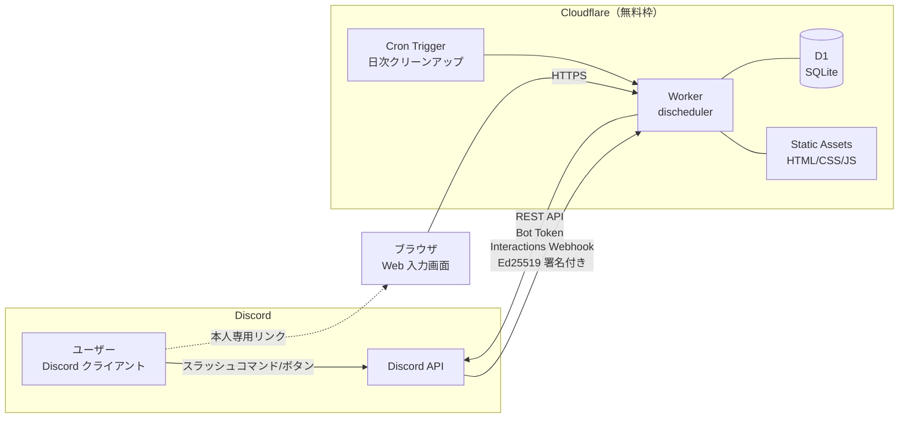
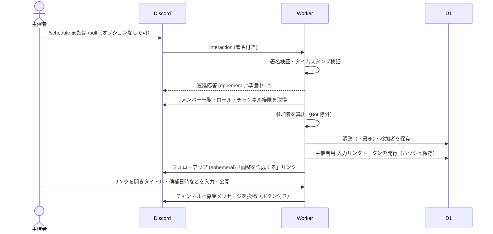
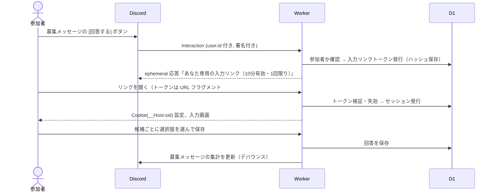
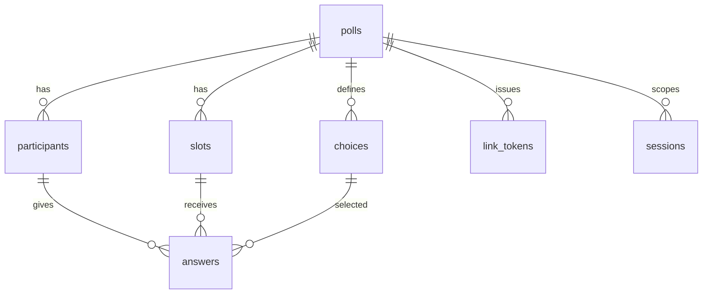
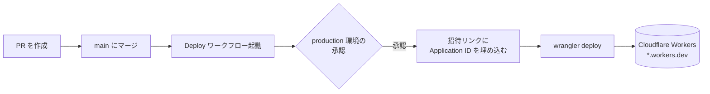

# DIscheduler 設計書

Discord のチャンネル（またはロール）のメンバー間で日程調整を行う Bot / Web アプリケーション。
Cloudflare Workers の無料枠のみで完結するサーバーレス構成とする。

- 版: 0.3
- 作成日: 2026-11-04
- 改訂: 2026-11-05（未決事項を確定: 保持期間 6 ヶ月、参加者抽出モード選択式、回答全員公開、作成権限、タイムゾーン設定）
- 改訂: 2026-11-06（回答の選択肢を主催者が変更できるようにした。§6.9）
- 改訂: 2026-11-06（回答画面（S3）に集計を表示するようにした。§6.4）
- 改訂: 2026-11-06（`/schedule` だけで作成を始められるようにし、タイトルを Web 画面で入力する形にした。別名 `/poll` を追加し、一覧・管理・使い方は応答のボタンにまとめた。§4.1, §4.4）
- 関連文書: [SECURITY.md](../SECURITY.md)（公開セキュリティ方針）、[docs/security-design.md](./security-design.md)（セキュリティ設計詳細）

---

## 1. 目的とスコープ

### 1.1 目的
Discord 上の集まり（ゲーム会・勉強会・オフ会など）の日程調整を、外部サービス（調整さん等）へのアカウント登録や URL 共有なしに、Discord 内から開始・回答・確定まで行えるようにする。

### 1.2 要件と対応方針

| # | 要件 | 対応方針 | 実現性 |
|---|------|----------|--------|
| R1 | チャンネルメンバー／ロールメンバーが参加者として初期表示される | 作成時に Discord REST API でギルドメンバーを取得し、チャンネル閲覧権限またはロール所持で絞り込んで参加者リストを生成 | ◎（標準は Server Members Intent による自動抽出。手動選択も選べる。§5.3） |
| R2 | 主催者が簡単に候補日時を入力できる（HTML） | Workers Static Assets で配信する Web 画面。カレンダーで日付を複数選択 → 時間帯を一括適用 | ◎ |
| R3 | メンバーが簡単に予定を入力できる | Discord のボタン → 本人専用リンク（ログイン不要）→ 選択肢（既定は ○△×）をタップするだけの Web 画面。選択肢の組み合わせと数は主催者が変更できる（§6.9） | ◎ |
| R4 | 入力方法がわかりやすく、候補日時が見やすい | 表形式（候補×メンバー）＋集計＋最有力候補のハイライト。回答画面でも各候補の集計を見ながら入力できる。スマホ優先レイアウト | ◎ |
| R5 | 確定日時を Discord イベントとして登録 | Guild Scheduled Event API で作成（Bot に「イベントの作成」権限が必要） | ◯（任意機能。権限がなければスキップ） |
| R6 | Cloudflare Workers でサーバーレス完結・維持費ゼロ | Workers Free + D1 Free + Static Assets + Cron Triggers のみ使用 | ◎（§9 で無料枠試算） |
| R7 | セキュリティ対策を徹底し、対策内容を公開 | 署名検証・最小権限・データ最小化・CSP 等を実装し、`SECURITY.md` と `/security` ページで公開 | ◎ |

### 1.3 スコープ外（初版）
- 繰り返し予定、外部カレンダー（Google/Outlook）連携
- 複数ギルドをまたいだ調整
- ネイティブアプリ

---

## 2. 用語

| 用語 | 意味 |
|------|------|
| 調整（Poll） | 1 件の日程調整。タイトル・候補日時・参加者・回答を持つ |
| 主催者（Organizer） | 調整を作成したユーザー。候補編集・確定・削除ができる |
| 参加者（Participant） | 回答を求められるユーザー。作成時に自動抽出され、主催者が増減できる |
| 候補（Slot） | 候補日時 1 件（開始・終了） |
| 選択肢（Choice） | 回答に使う記号と意味の組（既定は ○ 参加可／△ 未定／× 不可）。調整ごとに主催者が 2〜5 個で設定できる（§6.9） |
| 回答（Answer） | 参加者×候補 ごとに選んだ選択肢 1 つ |
| 入力リンク | 参加者本人だけに一時表示される、短命・使い捨ての Web 画面用リンク |

---

## 3. システム構成

### 3.1 全体構成図



### 3.2 採用技術

| 区分 | 技術 | 理由 |
|------|------|------|
| 実行環境 | Cloudflare Workers（Free） | 常駐プロセス不要。HTTP Interactions 方式なら Gateway 接続が不要 |
| Discord 連携 | HTTP Interactions Endpoint + REST API | WebSocket 常駐が不要でサーバーレスと相性が良い |
| DB | Cloudflare D1（Free） | SQL・トランザクション・プリペアドステートメントが使える。書込上限が KV より大きい |
| 静的配信 | Workers Static Assets | 無料・同一オリジンで配信でき CSP を厳しくできる |
| 定期処理 | Cron Triggers | 期限切れデータの自動削除 |
| 言語 | TypeScript | 型による入力検証の取りこぼし防止 |
| ルーティング | Hono | Workers ネイティブで軽量、依存が少ない |
| 入力検証 | Valibot | 軽量なスキーマ検証 |
| フロントエンド | 素の TypeScript（フレームワークなし）＋ Vite でビルド | 依存最小化・バンドル軽量化・サプライチェーンリスク低減 |
| CI | GitHub Actions | テスト・型検査・依存監査・CodeQL・デプロイ |

> 依存パッケージは「ランタイム依存は Hono と Valibot のみ」を原則とし、追加時はレビュー必須とする（§security-design 参照）。

### 3.3 Gateway を使わない理由
Discord Bot は通常 WebSocket（Gateway）に常時接続するが、Workers は常駐できない。本アプリはスラッシュコマンド・ボタン・モーダルのみで操作する設計とし、すべて HTTP の Interactions Webhook で受け取る。メンバー情報などは必要な時に REST API で取得する。

---

## 4. 利用フロー

### 4.1 調整の作成（主催者）



1. 主催者がチャンネルで **`/schedule`（または別名の `/poll`）とだけ入力して実行** する。コマンド入力に慣れていない人でも始められるよう、オプションはすべて任意とし、何も指定しなければ次の既定値で下書きを作る。

   | オプション | 既定値（指定しない場合） | Web 画面（S2）での変更 |
   |------------|--------------------------|------------------------|
   | `title`（最大 100 文字） | 空欄（S2 で入力する） | 可。**公開には必須** |
   | `members`（`auto`／`manual`） | `auto`（コマンドを実行したチャンネルを閲覧できるメンバー） | 可 |
   | `role` | なし | 可（指定するとそのロールのメンバーが参加者） |
   | `deadline` | 作成から 7 日後 | 可 |

   - コマンドのオプションは、慣れた人が入力を省くための近道という位置づけで、すべて S2 で入力・変更できる。
2. Worker は 3 秒以内に「遅延応答（ephemeral）」を返し、メンバー取得等は `ctx.waitUntil` で継続する。
3. 主催者だけに見えるメッセージで「調整を作成する」リンクを返す。
4. Web 画面でタイトルと候補日時を入力し「公開」すると、チャンネルに募集メッセージ（埋め込み＋ボタン）が投稿される。タイトルが空のままでは公開できない。

### 4.2 回答（参加者）



- 参加者は Discord ボタンを押すだけで本人確認済みの入力画面に入れる（Discord アカウントでの追加ログイン不要）。
- 簡易回答として、Discord 上の [全部○] [全部×] のようなショートカットは提供しない（誤操作防止）。代わりに Web 画面に「すべて［先頭の選択肢］にする」「すべて［最後の選択肢］にする」ボタンを置く（既定の ○△× なら「すべて○」「すべて×」）。

### 4.3 確定（主催者）

1. 主催者が Web 画面の集計表で候補を選び「この日時で確定」。
2. オプションで「Discord イベントとして登録」にチェック（場所: ボイスチャンネル選択 or 自由入力）。
3. Worker が
   - 調整のステータスを `fixed` に更新
   - 募集メッセージを「確定: <t:UNIX:F>」に編集し、参加者へメンション付きでお知らせを投稿（メンション有無は選択可）
   - Guild Scheduled Event を作成（権限がなければスキップし、その旨を主催者に表示）

### 4.4 その他のコマンド

| コマンド | 内容 | 実行者 |
|----------|------|--------|
コマンドは `/schedule` と、その別名の `/poll` の 2 つだけにする。

| コマンド | 内容 | 実行者 |
|----------|------|--------|
| `/schedule` | 新しい調整を作成（実行者が主催者になる）。オプションなしで実行できる | 許可されたチャンネルで発言・コマンド実行できる人なら誰でも（§5.4） |
| `/poll` | `/schedule` の別名。オプションも処理もまったく同じ（`schedule` の綴りが難しい人向け） | 同上 |

一覧・管理・使い方は、コマンドではなく **`/schedule`（`/poll`）の応答メッセージのボタン** から使う。応答は本人にだけ表示される（ephemeral）。

```
┌───────────────────────────────────────┐
│ 新しい日程調整の下書きを作りました。    │
│ [ 調整を作成する ]  ← 本人専用リンク    │
├───────────────────────────────────────┤
│ [このチャンネルの調整] [自分の調整を管理] [使い方] │
└───────────────────────────────────────┘
```

| ボタン | 内容 | 使える人 |
|--------|------|----------|
| 調整を作成する | S2 を開く本人専用リンク（10 分有効・1 回限り） | 実行者 |
| このチャンネルの調整 | このチャンネルの進行中の調整一覧（ephemeral） | 実行者 |
| 自分の調整を管理 | 自分が主催する調整の一覧と、管理リンクの再発行（ephemeral） | 実行者（主催する調整があるときのみ表示） |
| 使い方 | 使い方の説明とセキュリティ方針（`/security`）へのリンク（ephemeral） | 実行者 |

- `/schedule list` のように半角スペースで区切る形（サブコマンド）にすると、Discord の仕様上 `/schedule` だけでは実行できなくなる。`/schedule` だけで作成できることを優先し、サブコマンドは使わない。
- 一覧・管理・使い方だけを見たい場合も `/schedule` を実行してボタンを押す。同じ人が同じチャンネルに、タイトルも候補も未入力の下書きをすでに持っている場合は、新しく作らずにその下書きを使い回す。そのため、ボタンだけを使う目的で何度実行しても下書きは増えず、作成数の上限（§5.4.2）にも数えられない。未入力の下書きは 3 日で自動削除される（§7.4）。
- 募集メッセージにも [回答する] [集計を見る] [使い方] のボタンを置く。
- Bot をサーバーに追加したとき、または `/schedule` を初めて使ったときの応答に、使い方の短い説明を添える。
- `/poll` は `/schedule` と同じ定義で別のコマンドとして登録し、Worker では同じ処理に振り分ける。管理者が連携サービス設定でチャンネルを指定する場合は、Bot 全体の設定にすれば両方のコマンドに効く（コマンド単位で設定する場合は両方に同じ設定をする）。

---

## 5. Discord 連携詳細

### 5.1 Bot の登録
- インストールスコープ: `bot`, `applications.commands`（ギルドインストールのみ。ユーザーインストールは無効）
- Interactions Endpoint URL: `https://<worker-domain>/discord/interactions`
- コマンドはデプロイスクリプトから REST API（`PUT /applications/{id}/commands`）で登録

### 5.2 必要な Bot 権限（最小権限）

| 権限 | 用途 | 必須 |
|------|------|------|
| View Channels | 投稿先チャンネルの参照 | 必須 |
| Send Messages | 募集・確定メッセージの投稿 | 必須 |
| Embed Links | 埋め込み表示 | 必須 |
| Create Events | 確定日時の Discord イベント作成 | 任意（R5 を使う場合） |
| Manage Events | Bot が作成したイベントの編集・削除 | 任意 |

> **Administrator 権限は要求しない。** メッセージ内容（Message Content Intent）も不要のため要求しない。

### 5.3 参加者の決定（R1）

参加者の決め方は **選択式** とし、調整ごとに S2 画面（または `/schedule`・`/poll` の `members` オプション）で選ぶ。

| モード | 既定 | 内容 | 必要な設定 |
|--------|------|------|------------|
| `auto` | ◎ | チャンネル閲覧者またはロール所持者を自動抽出（下記手順） | Server Members Intent |
| `manual` | | 主催者が S2 画面でサーバーメンバーを検索・選択（`GET /guilds/{id}/members/search` を使用）、または User Select Menu で選択 | 不要 |

どちらのモードでも、自動抽出後に主催者が S2 画面で参加者を追加・削除できる。
Server Members Intent が無効のまま `auto` が選ばれた場合（API が 403 を返す）は、`manual` に自動で切り替えて主催者にその旨を表示する。

#### 自動抽出（`auto`）の手順

Discord には「チャンネルのメンバー一覧」API がないため、次の手順で算出する。

1. `GET /guilds/{guild_id}/members?limit=1000&after=…` でギルドメンバーを取得（ページング）
   - **Server Members Intent（特権インテント）を Developer Portal で有効化する必要がある**
2. 対象の決定
   - **ロール指定時**: `member.roles` に対象ロール ID を含むメンバー
   - **チャンネル指定時**: `GET /guilds/{id}/roles` と `GET /channels/{id}` の権限上書き（permission_overwrites）から、Discord 公式の権限計算アルゴリズムで `VIEW_CHANNEL` を持つメンバーを算出（スレッドの場合は親チャンネル、プライベートスレッドの場合は `GET /channels/{id}/thread-members`）
3. Bot アカウント（`user.bot = true`）を除外
4. 上限: 参加者 100 名（表の見やすさと Workers Free の CPU 時間 10ms を考慮）。超える場合はロール指定を案内

参加者以外が [回答する] を押した場合の挙動は調整ごとに選択:
- `closed`（既定）: 「この調整の参加者ではありません」と ephemeral で返す
- `open`: 押した人がそのサーバーのメンバーで、かつ募集メッセージのチャンネルを閲覧できる場合のみ参加者として追加して回答可能にする（外部の人は Discord のサーバーに入っていないためボタン自体を押せない）

### 5.4 コマンドの利用範囲と作成権限

**コマンドを使えるチャンネルは、サーバー管理者が Discord 標準の「連携サービス」設定で指定する。そのチャンネルで誰にコマンドを打たせるかは、Discord のチャンネル権限（発言者の制限）に任せる。** アプリ独自の許可リスト・ロール指定・管理コマンドは作らない。

| 決めること | 決める人 | 方法 |
|------------|----------|------|
| コマンドを使えるチャンネル | サーバー管理者 | Discord の連携サービス設定で、DIscheduler のコマンドを許可するチャンネルを指定 |
| そのチャンネルで誰がコマンドを打てるか | サーバー管理者 | Discord のチャンネル権限（「メッセージを送信」「アプリコマンドを使用」）で発言できる人を制限する。アプリ側では指定しない |
| 調整の主催者 | — | コマンドを実行できた人は誰でも作成でき、実行者がその調整の主催者になる |

- Discord 標準の機能を使う理由:
  - Discord 側で強制されるため、許可されていないチャンネルからのコマンドや、発言権限のない人のコマンドは **Worker に届かない**（アプリのバグで制限がすり抜けることがない）
  - 管理者が普段使っている画面でそのまま管理でき、Bot ごとの独自操作を覚える必要がない
  - アプリ側にサーバー設定を保存しないため、保存データが増えない
- スラッシュコマンドの `default_member_permissions` は未設定とし、導入直後は Discord の既定どおり全チャンネルで、そのチャンネルに発言できる人が使える。チャンネルの指定は管理者が §5.4.1 の手順で行う。
- 募集メッセージの [回答する] ボタンはコマンドではないため、この設定の影響を受けない（回答できるかどうかは参加者かどうかで判定する。§5.3）。
- 主催者以外が編集・確定・削除できないよう、アプリ側で認可チェックを行う（security-design E-2）。

#### 5.4.1 管理者向け設定手順（README・[使い方] ボタンに掲載）

1. Discord の「サーバー設定」→「連携サービス」→「DIscheduler」を開く
2. 「チャンネル」で「すべてのチャンネル」をオフにし、コマンドを使わせたいチャンネルを追加する
3. 「ロールとメンバー」は変更不要（`@everyone` のまま）
4. 指定したチャンネルで発言できる人を絞りたい場合は、そのチャンネルの「チャンネルの編集」→「権限」で「メッセージを送信」「アプリコマンドを使用」を許可するロールを設定する

> 「サーバー管理」権限を持つメンバーは、Discord の仕様上この設定にかかわらずコマンドを使える。

#### 5.4.2 作成数のレート制限

乱用や誤操作による大量作成を防ぐため、アプリ側で作成数を制限する（D1 のカウンタで判定。security-design D-2）。

| 単位 | 上限 | 超えた場合 |
|------|------|------------|
| ユーザーごと | 1 時間に 10 件 | 「作成数の上限に達しました。○分後に再度お試しください」と本人にだけ表示 |
| サーバーごと | 1 日に 100 件 | 同上（サーバー全体の上限である旨を表示） |
| 進行中の調整（下書き・募集中） | 1 チャンネルあたり 20 件 | 「進行中の調整が多すぎます。不要な調整を削除してください」と表示 |

### 5.5 募集メッセージの更新
- Interaction トークンは 15 分で失効するため、募集メッセージは **Bot トークンで投稿し**、`channel_id` と `message_id` を保存して `PATCH /channels/{id}/messages/{id}` で更新する。
- 回答保存のたびに更新すると API レート制限に触れるため、最終更新から 30 秒以内の更新はスキップし、Cron（または次回の回答時）で追いつかせる。
- メッセージには候補ごとの「参加できる」区分の選択肢の人数（既定では ○ の人数）と回答率のみを表示し、**誰が×かなど個人の回答はチャンネルに表示しない**（Web 画面で参加者のみ閲覧可）。

### 5.6 Discord イベント登録（R5）
`POST /guilds/{guild_id}/scheduled-events`

| フィールド | 値 |
|------------|----|
| `name` | 調整タイトル |
| `scheduled_start_time` / `scheduled_end_time` | 確定候補の開始・終了（ISO8601） |
| `entity_type` | `2`（VOICE）または `3`（EXTERNAL） |
| `channel_id` | VOICE の場合のボイスチャンネル |
| `entity_metadata.location` | EXTERNAL の場合の場所（最大 100 文字） |
| `privacy_level` | `2`（GUILD_ONLY） |
| `description` | 調整の説明（任意） |

失敗時（権限不足・過去日時など）は確定処理自体は成功させ、主催者にエラー理由を表示する。

---

## 6. Web 画面設計

### 6.1 共通方針
- スマートフォン（Discord アプリ内ブラウザ）での操作を最優先。最小タップ領域 44px。
- 日本語 UI。日時の表示・入力は §6.7 のタイムゾーン規則に従う（例: `11/12(水) 20:00–22:00 JST`）。
- ライト／ダークモード対応（Discord の利用者はダークが多い）。
- 外部 CDN・外部フォント・解析タグは一切読み込まない（CSP で禁止）。
- 色だけに頼らない（選択肢は記号＋色＋読み上げラベルで表示する）。

### 6.2 画面一覧

| ID | 画面 | URL | 利用者 |
|----|------|-----|--------|
| S0 | Bot の案内（LP） | `/` | 公開 |
| S1 | リンク検証（中継） | `/l#<token>` | 全員 |
| S2 | 候補日時入力 | `/p/{pollId}/edit` | 主催者 |
| S3 | 回答入力（各候補の集計つき） | `/p/{pollId}/answer` | 参加者 |
| S4 | 集計・確定 | `/p/{pollId}` | 参加者（全員が全員の回答を閲覧可。確定操作は主催者のみ） |
| S5 | エラー（期限切れ等） | — | 全員 |
| S6 | セキュリティ方針 | `/security` | 公開 |

- S0 と S6 は静的ページ（`public/index.html`、`public/security.html`）として Workers Static Assets から配信する。JavaScript は使わず、アプリと同じ CSP を `public/_headers` で付与する。
- **利用者向けのセキュリティ方針の正本は S6（`public/security.html`）とする。** リポジトリの `SECURITY.md` は、S6 へのリンクと脆弱性の報告窓口だけを載せる。
- LP の「サーバーに追加する」リンクの `client_id` は `__DISCORD_APPLICATION_ID__` と書いておき、デプロイ時に環境変数 `DISCORD_APPLICATION_ID` の値に置き換える。

### 6.3 S2: 候補日時入力（主催者）

```
┌──────────────────────────────────┐
│ 新しい日程調整                     │
├──────────────────────────────────┤
│ タイトル（必須）                   │
│   [ 定例会                     ]   │
├──────────────────────────────────┤
│ ① 日付をタップして選択（複数可）   │
│   ◀ 2026年11月 ▶                  │
│   日 月 火 水 木 金 土             │
│          [4] 5  6  7  8           │
│    9 10 [11][12] 13 14 15  ...     │
├──────────────────────────────────┤
│ ② 時間帯                          │
│   よく使う: [昼 12-13] [夜 20-22]  │
│   開始 [20:00▼] 終了 [22:00▼]      │
│   [＋ 選択中の日付に追加]          │
├──────────────────────────────────┤
│ ③ 候補一覧 (3件)                  │
│   11/4(水) 20:00–22:00     [×]    │
│   11/11(水) 20:00–22:00    [×]    │
│   11/12(木) 20:00–22:00    [×]    │
├──────────────────────────────────┤
│ ④ 回答の選択肢 [変更]             │
│   ○ 参加  △ 未定  × 不可          │
├──────────────────────────────────┤
│ 参加者 (12名) [編集]              │
│ 締切 11/11(水) 23:59 [変更]        │
│        [ 公開してチャンネルに投稿 ] │
└──────────────────────────────────┘
```

- 日付の複数選択 × 時間帯の一括適用で、10 候補でも数タップで作成可能。
- 「終日」チェックで時間なし候補も可。
- 候補上限 30 件。
- 公開後も候補の追加は可能（削除は回答済みの場合に確認ダイアログ）。
- 回答の選択肢は既定で ○△×。[変更] から組み合わせと数を変えられる（§6.9）。

### 6.4 S3: 回答入力（参加者）

予定を入れるときの目安にできるよう、回答画面の各候補に **ほかの参加者の回答状況（集計）** を並べて表示する。集計を見るために S4 へ移動する必要はない。

```
┌──────────────────────────────────────┐
│ 定例会   締切 11/11(水) 23:59         │
│ あなた: @yuka    回答 8/12 名  [↻ 更新]│
├──────────────────────────────────────┤
│★11/11(水) 20:00–22:00                 │
│   いまの回答: ○7 △1 ×0  ▓▓▓▓▓▓▓░  [誰が▼]│
│   [ ○ 参加 ] [ △ 未定 ] [ × 不可 ]     │
├──────────────────────────────────────┤
│ 11/4(水) 20:00–22:00                  │
│   いまの回答: ○4 △2 ×2  ▓▓▓▓▒▒░░  [誰が▼]│
│   [ ○ 参加 ] [ △ 未定 ] [ × 不可 ]     │
├──────────────────────────────────────┤
│ 11/12(木) 20:00–22:00                 │
│   いまの回答: ○2 △1 ×5  ▓▓▒░░░░░  [誰が▼]│
│   [ ○ 参加 ] [ △ 未定 ] [ × 不可 ]     │
├──────────────────────────────────────┤
│ [すべて○] [すべて×]                   │
│ ひとこと（任意, 100字）[            ]  │
│ [ 集計表を見る ]       [ 保存する ]    │
└──────────────────────────────────────┘
   [誰が▼] を開いた例:
   ○ @a @b @c @d @e @f @g   △ @h   未回答 @i @j @k @l
```

- 1 候補 1 行のセグメントボタン（ラジオボタン）。ボタンの数と記号・名前は、その調整の選択肢（§6.9）に合わせて変わる。未回答は灰色。
- **集計の表示**
  - 各候補のボタンの上に「いまの回答」として、選択肢ごとの人数と、区分ごとに色分けした横棒を表示する。★は最有力候補（§6.9.3）。
  - [誰が▼] を開くと、その候補で誰がどの選択肢を選んだか、未回答は誰かを表示する（参加者間で共有する範囲内。§6.6）。
  - 集計には **保存済みの回答** を数える。自分の回答も、保存した時点で集計に入る。保存前に選んだ内容は数えず、画面上で選び直しても集計の数字は変わらない（自分の入力で目安が動いて見えないようにするため）。
  - [集計表を見る] で S4 の集計表（メンバー別の表を含む）を開く。入力中の内容は、保存するまで S3 に残る。
- **集計の更新**
  - 画面を開いたとき、保存したとき、[↻ 更新] を押したとき、ほかのタブから戻ったとき（`visibilitychange`）に取得し直す。
  - 一定間隔での自動更新はしない（Workers 無料枠のリクエスト数を節約するため）。
- まだ誰も回答していない候補は「まだ回答がありません」と表示する。
- 保存後は画面に残り、集計に自分の回答が反映される。続けて S4 を見たい人は [集計表を見る] を押す。
- 締切後は閲覧のみ（集計は見られる）。
- 集計は `GET /api/polls/{id}` で回答画面の表示に必要な情報と一緒に取得する（§8.1）。参加者以外には返さない。

### 6.5 S4: 集計・確定

```
┌────────────────────────────────────────────┐
│ 定例会   回答 9/12 名                        │
├───────────────┬───┬───┬───┬──────┬───────┤
│ 候補           │ ○ │ △ │ × │ 未回答│       │
├───────────────┼───┼───┼───┼──────┼───────┤
│★11/11(水)20:00│ 8 │ 1 │ 0 │  3   │[確定] │
│ 11/4(水) 20:00│ 5 │ 2 │ 2 │  3   │[確定] │
│ 11/12(木)20:00│ 3 │ 1 │ 5 │  3   │[確定] │
└───────────────┴───┴───┴───┴──────┴───────┘
 [ メンバー別に表示 ▼ ]
   (候補×メンバーのマトリクス。横スクロール、名前列固定。
    参加者全員が全員の回答とひとことを閲覧できる)
 未回答: @a @b @c   [未回答者にリマインド]
```

- 表の列は、その調整の選択肢（§6.9）ごとに並ぶ（上の図は既定の ○△× の場合）。
- 並び順: 日時順／点数の高い順を切替。★は最有力候補で、「不可」区分の人数が最少 → 点数の合計が最大 → 「参加できる」区分の人数が最多、の順で決める（§6.9.3）。
- [確定] と [リマインド] は主催者にのみ表示（サーバー側でも認可）。
- リマインドは未回答者のみメンションして 1 回投稿（同一調整で 12 時間に 1 回まで）。

### 6.6 回答の公開範囲
- 個人ごとの回答（選んだ選択肢）とひとことコメントは **その調整の参加者全員（と主催者）に公開** する（S4 のメンバー別表示）。回答を共有すること自体がこのツールの目的であり、参加者間の共有は仕様とする。
- S3 画面に「あなたの回答は、この調整の参加者全員に表示されます」と明記する。

#### 外部の人から見えないようにする仕組み

「外部の人」とは、その調整の参加者・主催者 **以外のすべての人** を指す（インターネット上の第三者、同じサーバーにいても参加者でない人、別の調整の参加者、参加者から外された人を含む）。

| 経路 | 対策 |
|------|------|
| URL を直接開く・URL を推測する | 画面と API はすべてセッション必須。調整 ID だけでは何も表示されない（ログイン画面もなく「リンクの有効期限が切れています」と表示するのみ）。調整 ID は 128bit ランダム |
| 公開・共有用リンク | **作らない**。誰でも見られる閲覧 URL・埋め込み・CSV エクスポート機能は提供しない |
| 入力リンクの取得 | Discord の署名付き Interaction で、押した本人が参加者であると確認できた場合のみ、本人にしか見えないメッセージ（ephemeral）で発行。10 分・1 回限り |
| 別の調整のセッションで覗く | セッションは調整 1 件に限定。他の調整の API は 403 |
| 参加者から外された人 | 外した時点でその人のセッションを即時削除し、以後リンクも発行しない |
| 調整が削除された後 | データを物理削除し、セッションも同時に削除 |
| チャンネルの募集メッセージ | 候補ごとの「参加できる」区分の人数と回答率のみ。個人名と回答の組み合わせは出さない |
| 確定のお知らせ・Discord イベント | 確定日時と参加者へのメンションのみ。個人ごとの回答は載せない。Discord イベントは `GUILD_ONLY`（サーバー内限定） |
| 検索エンジン・キャッシュ | `X-Robots-Tag: noindex`、`Cache-Control: no-store`。CDN や共有キャッシュに回答を残さない |
| Bot の開発・運用者 | 運用者向けの閲覧画面は作らない。ログに回答内容・表示名を出力しない |

### 6.7 タイムゾーン

| 対象 | 既定値の決め方 | 変更 |
|------|----------------|------|
| 調整のタイムゾーン（候補日時を入力する基準） | 主催者が初めて S2 を開いたときの **ブラウザのタイムゾーン**（`Intl.DateTimeFormat().resolvedOptions().timeZone`）。取得できない・不正な値なら `Asia/Tokyo` | 主催者が S2 のタイムゾーン選択で変更可 |
| 閲覧者ごとの表示タイムゾーン | 閲覧者の **ブラウザのタイムゾーン**。取得できなければ `Asia/Tokyo` | S3/S4 画面右上のタイムゾーン選択で変更可。選択値は閲覧者のブラウザ（localStorage）にのみ保存し、サーバーには保存しない |

- Discord の Interaction にはユーザーのタイムゾーン情報が含まれない（`locale` は言語のみ）ため、タイムゾーンの判定はブラウザで行う。
- 閲覧者の表示タイムゾーンが調整のタイムゾーンと異なる場合は、両方を併記する（例: `11/12(水) 20:00 JST（あなたの時刻: 11/12(水) 12:00 CET）`）。
- サーバー側は日時をすべて UTC の UNIX 秒で保存・処理し、タイムゾーンは IANA 名（例 `Asia/Tokyo`）で保存する。受け取ったタイムゾーン名は `Intl.supportedValuesOf('timeZone')` に含まれるかで検証する。
- Discord のメッセージ内の日時は `<t:UNIX:F>` 形式で書くため、Discord が各ユーザーの端末のタイムゾーンで自動表示する。
- Discord イベントは UTC で登録するため、タイムゾーンによるずれは生じない。

### 6.8 リンク中継（S1）の仕組み
1. ephemeral メッセージのリンク: `https://<domain>/l#t=<token>`
   - トークンを**フラグメント**に置くことで、サーバーログ・Referer・プロキシに残らない。
2. S1 の JS がフラグメントを読み取り、`history.replaceState` で URL から即座に消去した上で `POST /api/session` に送信。
3. サーバーはトークンを検証・失効し、`__Host-sid` Cookie を発行して対象画面へリダイレクト。

---

### 6.9 回答の選択肢のカスタマイズ

主催者は、調整ごとに回答の選択肢の **組み合わせと数** を変更できる。既定は ○（参加）・△（未定）・×（不可）の 3 つ。

#### 6.9.1 選択肢の設定項目

| 項目 | 内容 | 制約 |
|------|------|------|
| 記号 | ボタンと表に出す短い記号（例: ◎ ○ △ × ？） | 1〜2 文字（書記素単位）。改行・制御文字・双方向制御文字・Discord のカスタム絵文字記法（`<:name:id>`）は不可 |
| 名前 | 記号の意味（例: 参加、たぶん参加、未定、不可） | 1〜10 文字。同じ調整の中で重複不可 |
| 区分 | `ok`（参加できる）／`maybe`（未定・条件付き）／`ng`（参加できない） | 集計・★の判定・チャンネル表示に使う。`ok` と `ng` はそれぞれ 1 つ以上必須 |
| 点数 | 最有力候補の判定に使う重み | 0〜10 の整数。既定値は区分から自動で入る（ok=2、maybe=1、ng=0） |
| 色 | 表示色 | 区分ごとの固定パレット（緑・黄・赤など）から選ぶ。任意の色コードは受け付けない |
| 並び順 | ボタンと表の列の順 | ドラッグまたは上下ボタンで変更 |

- 選択肢の数は **2〜5 個**。
- 入力値は他の入力と同じく、スキーマとサーバー側で検証する（security-design §4.4）。

#### 6.9.2 用意するひな形

S2 の [変更] を押すと、ひな形から選ぶか、自分で編集できる。

| ひな形 | 選択肢（記号 名前／区分／点数） |
|--------|-------------------------------|
| 標準（既定） | ○ 参加／ok／2、△ 未定／maybe／1、× 不可／ng／0 |
| 2 択 | ○ 参加／ok／1、× 不可／ng／0 |
| 4 段階 | ◎ ぜひ参加／ok／3、○ 参加できる／ok／2、△ 未定／maybe／1、× 不可／ng／0 |
| 時間の条件つき | ○ 参加／ok／3、遅 遅れて参加／maybe／2、早 途中で抜ける／maybe／2、× 不可／ng／0 |
| 自分で作る | 上のどれかをもとに、記号・名前・区分・点数・色を編集し、追加・削除する |

```
┌──────────────────────────────────┐
│ 回答の選択肢                       │
│ ひな形: [標準 ▼]                   │
├──────────────────────────────────┤
│ ≡ [○ ] [参加    ] [参加できる▼] 2 [削除]│
│ ≡ [△ ] [未定    ] [未定      ▼] 1 [削除]│
│ ≡ [× ] [不可    ] [参加できない▼] 0 [削除]│
│ [＋ 選択肢を追加]（最大 5 個）      │
├──────────────────────────────────┤
│ プレビュー: [○ 参加][△ 未定][× 不可] │
│                 [ キャンセル ][ 保存 ] │
└──────────────────────────────────┘
```

#### 6.9.3 集計と最有力候補（★）
- 表には選択肢ごとの人数を並べ、区分ごとの合計も出す。
- 点数の合計 = Σ（その候補で各選択肢を選んだ人数 × 選択肢の点数）。未回答は数えない。
- ★の判定順:
  1. `ng` 区分の人数が最も少ない
  2. 点数の合計が最も大きい
  3. `ok` 区分の人数が最も多い
  4. それでも同じなら日時が早い候補
- チャンネルの募集メッセージには、候補ごとの `ok` 区分の人数と回答率だけを表示する（§5.5）。

#### 6.9.4 公開後の変更
回答が集まった後に選択肢を変えると、回答の意味が変わってしまうため、次のルールにする。

| 操作 | 回答がまだない場合 | 回答がある場合 |
|------|-------------------|----------------|
| 記号・名前・色・並び順の変更 | 可 | 可（回答はそのまま。変更内容を S3 の上部に「選択肢が変更されました」と表示） |
| 区分・点数の変更 | 可 | 可（確認ダイアログを出し、集計と★を再計算） |
| 選択肢の追加 | 可 | 可（既存の回答はそのまま） |
| 選択肢の削除 | 可 | その選択肢を選んだ回答の **移し先** を主催者が選ぶ（例: 「たぶん参加」→「未定」）。移し先を選ばずに削除はできない |

- どの変更も主催者だけが行え、サーバー側で認可する。
- 締切後・確定後は変更できない。
- 変更時は `polls.choices_version` を 1 増やし、回答画面を開いている参加者が古い選択肢で保存しようとした場合は 409 を返して画面を再読み込みさせる。

## 7. データ設計（D1）

### 7.1 ER 概要



### 7.2 テーブル定義

```sql
-- 調整
CREATE TABLE polls (
  id              TEXT PRIMARY KEY,          -- ランダム 128bit (base64url)
  guild_id        TEXT NOT NULL,
  channel_id      TEXT NOT NULL,
  message_id      TEXT,                      -- 募集メッセージ
  organizer_id    TEXT NOT NULL,             -- Discord user ID
  title           TEXT CHECK (title IS NULL OR length(title) BETWEEN 1 AND 100), -- 下書きでは NULL 可。公開時に必須
  description     TEXT CHECK (length(description) <= 1000),
  timezone        TEXT NOT NULL DEFAULT 'Asia/Tokyo', -- IANA 名。主催者のブラウザ TZ で上書き（§6.7）
  timezone_set    INTEGER NOT NULL DEFAULT 0,       -- 1 = 主催者が設定済み（以後ブラウザ TZ で上書きしない）
  target_type     TEXT NOT NULL CHECK (target_type IN ('channel','role','manual')),
  target_id       TEXT,
  join_policy     TEXT NOT NULL DEFAULT 'closed' CHECK (join_policy IN ('closed','open')),
  status          TEXT NOT NULL DEFAULT 'draft'
                  CHECK (status IN ('draft','open','closed','fixed','cancelled')),
  deadline_at     INTEGER,                   -- UNIX 秒 (UTC)
  fixed_slot_id   TEXT,
  discord_event_id TEXT,
  choices_version INTEGER NOT NULL DEFAULT 1, -- 選択肢を変更するたびに +1（§6.9.4）
  last_synced_at  INTEGER,                   -- 募集メッセージ最終更新
  created_at      INTEGER NOT NULL,
  updated_at      INTEGER NOT NULL,
  purge_after     INTEGER NOT NULL           -- この時刻以降に物理削除
);
CREATE INDEX idx_polls_channel ON polls(guild_id, channel_id, status);
CREATE INDEX idx_polls_purge ON polls(purge_after);

-- 候補日時
CREATE TABLE slots (
  id        TEXT PRIMARY KEY,
  poll_id   TEXT NOT NULL REFERENCES polls(id) ON DELETE CASCADE,
  start_at  INTEGER NOT NULL,                -- UNIX 秒 (UTC)
  end_at    INTEGER,                         -- NULL = 終了時刻なし
  all_day   INTEGER NOT NULL DEFAULT 0,
  position  INTEGER NOT NULL,
  UNIQUE (poll_id, start_at, end_at)
);

-- 回答の選択肢（調整ごとに 2〜5 個。§6.9）
CREATE TABLE choices (
  id        TEXT PRIMARY KEY,
  poll_id   TEXT NOT NULL REFERENCES polls(id) ON DELETE CASCADE,
  symbol    TEXT NOT NULL CHECK (length(symbol) BETWEEN 1 AND 8),  -- 表示は 1〜2 書記素（アプリ側で検証）
  label     TEXT NOT NULL CHECK (length(label) BETWEEN 1 AND 10),
  kind      TEXT NOT NULL CHECK (kind IN ('ok','maybe','ng')),
  score     INTEGER NOT NULL CHECK (score BETWEEN 0 AND 10),
  color     TEXT NOT NULL CHECK (color IN ('green','teal','yellow','orange','red','gray')),
  position  INTEGER NOT NULL,
  UNIQUE (poll_id, label)
);

-- 参加者
CREATE TABLE participants (
  poll_id       TEXT NOT NULL REFERENCES polls(id) ON DELETE CASCADE,
  user_id       TEXT NOT NULL,
  display_name  TEXT NOT NULL CHECK (length(display_name) <= 64), -- 表示用キャッシュ
  comment       TEXT CHECK (length(comment) <= 100),
  answered_at   INTEGER,
  PRIMARY KEY (poll_id, user_id)
);

-- 回答
CREATE TABLE answers (
  poll_id  TEXT NOT NULL,
  slot_id  TEXT NOT NULL REFERENCES slots(id) ON DELETE CASCADE,
  user_id  TEXT NOT NULL,
  choice_id TEXT NOT NULL REFERENCES choices(id),   -- 削除時は移し先へ付け替えてから消す（§6.9.4）
  PRIMARY KEY (slot_id, user_id),
  FOREIGN KEY (poll_id, user_id) REFERENCES participants(poll_id, user_id) ON DELETE CASCADE
);

-- 入力リンク用ワンタイムトークン（ハッシュのみ保存）
CREATE TABLE link_tokens (
  token_hash  TEXT PRIMARY KEY,              -- SHA-256(token)
  poll_id     TEXT NOT NULL REFERENCES polls(id) ON DELETE CASCADE,
  user_id     TEXT NOT NULL,
  role        TEXT NOT NULL CHECK (role IN ('organizer','participant')),
  expires_at  INTEGER NOT NULL,              -- 発行から 10 分
  used_at     INTEGER
);

-- Web セッション（ハッシュのみ保存）
CREATE TABLE sessions (
  sid_hash    TEXT PRIMARY KEY,              -- SHA-256(session id)
  poll_id     TEXT NOT NULL REFERENCES polls(id) ON DELETE CASCADE,
  user_id     TEXT NOT NULL,
  role        TEXT NOT NULL,
  csrf_token  TEXT NOT NULL,
  expires_at  INTEGER NOT NULL,              -- 発行から 12 時間（延長なし）
  created_at  INTEGER NOT NULL
);
CREATE INDEX idx_sessions_exp ON sessions(expires_at);

-- レート制限カウンタ（固定ウィンドウ）
CREATE TABLE rate_limits (
  key         TEXT PRIMARY KEY,              -- 例: "answer:<user_id>:<window>"
  count       INTEGER NOT NULL,
  expires_at  INTEGER NOT NULL
);
```

### 7.3 保存しないデータ（データ最小化）
- Discord のアクセストークン・リフレッシュトークン（OAuth を使わないため存在しない）
- Interaction トークン
- メールアドレス・IP アドレス（ログにも残さない。レート制限キーにも用いない）
- メッセージ本文（Message Content Intent を使わない）
- アバター画像（表示する場合も Discord CDN の URL を都度生成し保存しない → 初版はアバター非表示）

### 7.4 データ保持期間
| 状態 | 物理削除のタイミング |
|------|---------------------|
| `draft`（未公開） | 作成から 3 日後 |
| `open` / `closed` | 締切から 6 ヶ月（180 日）後 |
| `fixed` | 確定日時から 6 ヶ月（180 日）後 |
| `cancelled` | 即時 |
| link_tokens / sessions / rate_limits | 期限切れ後、日次 Cron で削除 |

主催者は `/schedule` の［自分の調整を管理］から即時削除できる。Bot がギルドから削除された場合（Gateway を使わないため削除イベントは受け取れない）は、日次 Cron で `GET /users/@me/guilds` と保存済みギルドを突き合わせ、または API の 403/404 応答を検知して、該当ギルドのデータを削除する。

---

## 8. API 設計

### 8.1 エンドポイント一覧

| メソッド | パス | 認証 | 説明 |
|----------|------|------|------|
| POST | `/discord/interactions` | Ed25519 署名 | Discord からの Interaction 受信 |
| POST | `/api/session` | ワンタイムトークン | トークンをセッションへ交換 |
| DELETE | `/api/session` | セッション + CSRF | ログアウト |
| GET | `/api/polls/{id}` | セッション | 調整情報・候補・集計・（参加者のみ）回答一覧 |
| PATCH | `/api/polls/{id}` | セッション(主催者) + CSRF | タイトル・説明・締切・参加者の決め方・タイムゾーンの更新 |
| PUT | `/api/polls/{id}/slots` | セッション(主催者) + CSRF | 候補日時の一括更新 |
| PUT | `/api/polls/{id}/choices` | セッション(主催者) + CSRF | 回答の選択肢の一括更新（削除時は移し先を指定。§6.9.4） |
| PUT | `/api/polls/{id}/participants` | セッション(主催者) + CSRF | 参加者の追加・削除 |
| POST | `/api/polls/{id}/publish` | セッション(主催者) + CSRF | 公開し募集メッセージ投稿 |
| PUT | `/api/polls/{id}/answers/me` | セッション(参加者) + CSRF | 自分の回答を保存 |
| POST | `/api/polls/{id}/fix` | セッション(主催者) + CSRF | 確定（イベント登録オプション） |
| POST | `/api/polls/{id}/remind` | セッション(主催者) + CSRF | 未回答者リマインド |
| DELETE | `/api/polls/{id}` | セッション(主催者) + CSRF | 調整削除 |
| GET | `/security` | なし | セキュリティ方針（静的） |
| GET | `/*` | なし | 静的アセット |

- セッションは **発行対象の調整 1 件に限定**（`sessions.poll_id`）。他の調整の API はセッションがあっても 403。
- すべての JSON 入力は Valibot スキーマで検証し、未知フィールドは拒否。

### 8.2 リクエスト例

`PUT /api/polls/{id}/answers/me`
```json
{
  "answers": [
    { "slotId": "q3k...", "choiceId": "c1a..." },
    { "slotId": "z8a...", "choiceId": "c3x..." }
  ],
  "choicesVersion": 1,
  "comment": "21時からなら確実です"
}
```
ヘッダー: `Content-Type: application/json`, `X-CSRF-Token: <token>`

- `choiceId` はその調整の選択肢であること、`choicesVersion` が現在の値と一致することをサーバーで検証する（不一致は 409）。

`PUT /api/polls/{id}/choices`
```json
{
  "choicesVersion": 1,
  "choices": [
    { "id": "c1a...", "symbol": "◎", "label": "ぜひ参加", "kind": "ok", "score": 3, "color": "green" },
    { "id": null,     "symbol": "○", "label": "参加できる", "kind": "ok", "score": 2, "color": "teal" },
    { "id": "c3x...", "symbol": "×", "label": "不可", "kind": "ng", "score": 0, "color": "red" }
  ],
  "reassign": [
    { "from": "c2b...", "to": "c3x..." }
  ]
}
```
- `id: null` は新しい選択肢。リストにない既存の選択肢は削除扱いで、回答がある場合は `reassign` に移し先が必要。

### 8.3 Interaction の custom_id 設計
`custom_id` は Discord クライアント側で改ざんされうる前提で扱う。

| custom_id | 処理 |
|-----------|------|
| `answer:{pollId}` | 押下ユーザー（Interaction の `member.user.id`）を参加者として検証し、入力リンクを発行 |
| `view:{pollId}` | 集計閲覧用リンクを発行（`answer` と同じく、押した本人が参加者の場合のみ） |

ユーザー ID は必ず Discord が署名した Interaction 本体の値を使い、`custom_id` には含めない。

---

## 9. 無料枠での運用試算（R6）

| リソース | 無料枠（2026-11 時点の公表値。導入時に再確認） | 想定使用量（50 調整/日・各 20 名回答の場合） |
|----------|------------------------------|----------------------------|
| Workers リクエスト | 100,000 / 日 | 約 5,000 / 日 |
| Workers CPU 時間 | 10 ms / リクエスト | 署名検証・JSON 処理で 1–5 ms 想定。メンバー取得は 1000 件/ページ単位で処理 |
| Workers サブリクエスト | 50 / リクエスト | 最大でもメンバー取得 5 ページ＋ロール＋チャンネル＋投稿 ≒ 10 |
| D1 読み取り | 5,000,000 行 / 日 | 約 100,000 行 / 日 |
| D1 書き込み | 100,000 行 / 日 | 約 5,000 行 / 日 |
| D1 ストレージ | 5 GB | 6 ヶ月保持で約 9,000 調整・18 万回答行 ≒ 数十 MB 以内 |
| Static Assets | 無料・無制限リクエスト | — |
| Cron Triggers | 無料プランで利用可 | 1 本（日次） |

- 独自ドメインは不要（`*.workers.dev` を使用）。独自ドメインを使う場合のみドメイン費用が発生。
- 無料枠を超えた場合、Workers はエラー応答になる（課金は発生しない）。超過時は Discord 上で「混雑中」と表示する。
- **有料プランへの自動アップグレードは行わない**（Cloudflare アカウントに支払い情報を登録しない運用も可能）。

---

## 10. 非機能要件

| 項目 | 目標 |
|------|------|
| 応答時間 | Interaction 初回応答 3 秒以内（遅延応答を利用）、Web API p95 500ms 以内 |
| 可用性 | Cloudflare の SLA に準ずる（無料プランのため SLA なし） |
| 同時編集 | 回答は本人の行のみ更新するため競合なし。候補編集は `updated_at` による楽観ロック |
| アクセシビリティ | WCAG 2.2 AA を目標（コントラスト、キーボード操作、スクリーンリーダーラベル） |
| 対応ブラウザ | 最新の Chrome / Safari / Firefox / Edge、Discord アプリ内ブラウザ |
| 監視 | Workers Observability（ログは個人情報をマスクし、7 日保持） |

---

## 11. リポジトリ構成（予定）

```
DIscheduler/
├── SECURITY.md               # 公開ページへのリンクと脆弱性報告窓口
├── README.md
├── docs/
│   ├── design.md             # 本書
│   └── security-design.md    # セキュリティ設計詳細・脅威モデル
├── src/
│   ├── index.ts              # Worker エントリ (fetch / scheduled)
│   ├── discord/
│   │   ├── verify.ts         # Ed25519 署名検証
│   │   ├── interactions.ts   # コマンド・ボタン処理
│   │   ├── rest.ts           # REST クライアント（レート制限対応）
│   │   └── permissions.ts    # チャンネル閲覧権限計算
│   ├── api/                  # Web API ハンドラ
│   ├── auth/                 # トークン・セッション・CSRF
│   ├── db/                   # D1 クエリ（プリペアドステートメントのみ）
│   ├── security/             # ヘッダー・レート制限
│   └── schemas/              # Valibot スキーマ
├── public/                   # Workers Static Assets の配信元
│   ├── index.html            # S0: Bot の案内（LP）
│   ├── security.html         # S6: セキュリティ方針（公開の正本）
│   ├── assets/site.css       # 公開ページ共通のスタイル
│   ├── _headers              # 静的配信時のセキュリティヘッダー
│   └── robots.txt            # / と /security 以外のクロールを拒否
├── web/                      # アプリ画面（S1〜S5）のソース（Vite で public/app/ にビルド）
├── migrations/               # D1 マイグレーション
├── scripts/register-commands.ts
├── test/                     # Vitest + @cloudflare/vitest-pool-workers
├── wrangler.jsonc            # Cloudflare Workers の設定
└── .github/
    ├── workflows/deploy.yml  # main マージ時のデプロイ（承認制）
    ├── workflows/            # CI（test, typecheck, audit, CodeQL）※実装時に追加
    └── dependabot.yml        # Action の更新
```

---

## 12. 実装計画

| フェーズ | 内容 |
|----------|------|
| P1 基盤 | Worker 雛形、署名検証、`/schedule`・`/poll` の登録と［使い方］ボタン、D1 マイグレーション、セキュリティヘッダー、CI |
| P2 作成 | `/schedule`・`/poll` による作成、［このチャンネルの調整］［自分の調整を管理］ボタン、参加者決定（auto: channel/role、manual）、リンク発行・セッション、S2 画面、公開投稿 |
| P3 回答 | [回答する] ボタン、S3/S4 画面、募集メッセージ集計更新、レート制限 |
| P4 確定 | 確定処理、Discord イベント登録、リマインド |
| P5 運用 | Cron 削除、`/security` ページ、脅威モデルレビュー、負荷・CPU 時間計測、README の導入手順 |

---

## 13. 決定事項（2026-11-05、#7 は 2026-11-06 追加）

| # | 項目 | 決定 | 反映箇所 |
|---|------|------|----------|
| 1 | データ保持期間 | 締切／確定から **6 ヶ月（180 日）** 後に自動削除 | §7.4 |
| 2 | 参加者の決め方 | **選択式**。標準は Server Members Intent による自動抽出（`auto`）、手動選択（`manual`）も選べる | §4.1, §5.3 |
| 3 | 回答の公開範囲 | 個人ごとの回答を **参加者全員に公開** | §6.5, §6.6 |
| 7 | 回答の選択肢 | 主催者が調整ごとに組み合わせと数（2〜5 個）を変更できる。既定は ○△× | §6.9 |
| 4 | 作成権限 | コマンドを使えるチャンネルと、管理者以外に使わせるかは、サーバー管理者が Discord 標準の連携サービス設定で決める。コマンドを実行できた人は誰でも作成可（実行者が主催者）。作成数のレート制限あり | §5.4 |
| 5 | タイムゾーン | 設定変更可能。既定はユーザーのブラウザのタイムゾーン、不明なら `Asia/Tokyo` | §6.7 |
| 6 | ドメイン | `*.workers.dev` を使用（独自ドメインなし） | §9 |

- Server Members Intent は Bot の導入サーバーが 100 未満なら Discord の審査なしで、Developer Portal の設定だけで有効化できる。100 サーバー以上になる場合は Discord への申請が必要。

---

## 14. デプロイ

GitHub Actions から Cloudflare Workers にデプロイする（`.github/workflows/deploy.yml`）。



### 14.1 初回の準備

**Cloudflare**
1. 無料アカウントを作り、「Workers & Pages」で `workers.dev` のサブドメインを決める（公開 URL は `https://discheduler.<サブドメイン>.workers.dev`）。
2. Account ID を控える。
3. 「My Profile → API Tokens → Create Token」でテンプレート「Edit Cloudflare Workers」を選び、Account Resources を自分のアカウントだけに限り、有効期限（最長 1 年）を付けてトークンを作る。

**GitHub**（リポジトリの Settings → Environments → `production`）

| 種類 | 名前 | 値 |
|------|------|----|
| 保護ルール | Required reviewers | 承認者（自分） |
| 保護ルール | Deployment branches | `main` のみ |
| Environment secret | `CLOUDFLARE_API_TOKEN` | 上で作った API トークン |
| Environment secret | `CLOUDFLARE_ACCOUNT_ID` | Account ID |
| Environment variable | `DISCORD_APPLICATION_ID` | Discord Developer Portal の Application ID（公開値） |

### 14.2 ワークフローの安全策
- `permissions: contents: read` のみ。`actions/checkout` は `persist-credentials: false` で GitHub トークンを残さない。
- サードパーティの Action はコミット SHA で固定し、Dependabot（`.github/dependabot.yml`）で週次に更新 PR を作る。
- wrangler のバージョンを固定する（`wranglerVersion`）。
- `DISCORD_APPLICATION_ID` は数字 17〜20 桁であることを確かめてから置き換える。置き換え漏れがあればデプロイを止める。
- 同時に 2 つのデプロイが走らないよう `concurrency` で直列化する。
- プレビュー URL は無効（`preview_urls: false`）にし、公開されるのは `workers.dev` の本番 URL だけにする。
- Bot トークンなどの秘密の値は GitHub に置かず、Worker 実装後に `wrangler secret put` で Cloudflare に直接登録する。

### 14.3 実装開始後に追加するもの
- デプロイ前に `npm ci --ignore-scripts`、型検査、テスト、`npm audit` を実行するジョブ（失敗したらデプロイしない）
- D1 のマイグレーション（`wrangler d1 migrations apply --remote`）
- スラッシュコマンドの登録（`scripts/register-commands.ts`）
