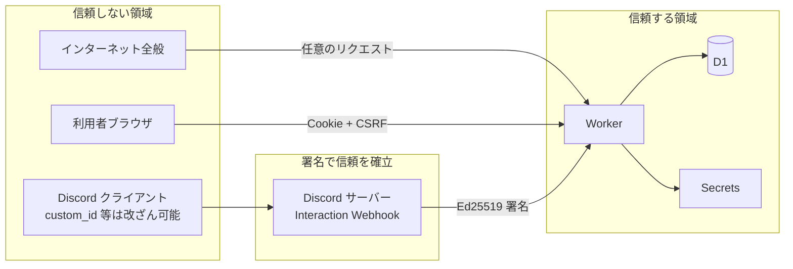
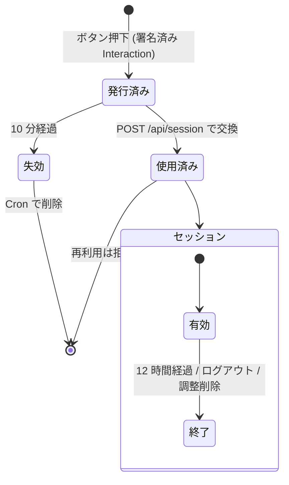

# DIscheduler セキュリティ設計書

本書は DIscheduler のセキュリティ設計の詳細（脅威モデル・対策・検証方法）を記述する。
**本書はリポジトリとともに公開し、Web 画面の `/security` からも参照できるようにする。**
利用者向けのセキュリティ方針は、公開ページ `/security`（ソースは [public/security.html](../public/security.html)）を参照。

- 版: 1.0（初版）
- 作成日: 2026-11-06

> 公開方針: 「仕組みを隠すことで守る」設計は採らない。本書の内容がすべて公開されても安全であることを前提に設計する（ケルクホフスの原理）。秘密にするのは鍵・トークンのみ。

---

## 1. 保護対象（資産）

| 資産 | 内容 | 重要度 |
|------|------|--------|
| A1 Bot トークン | Discord Bot として API を操作できる資格情報 | 最高 |
| A2 Discord 公開鍵 | 署名検証に使用（公開情報だが改ざん防止が必要） | 高 |
| A3 Cloudflare API トークン | デプロイ用 | 最高 |
| A4 参加者の予定回答 | 誰がいつ空いているか（生活パターンの推測につながる） | 高 |
| A5 参加者リスト | Discord ユーザー ID・表示名・どのサーバー/ロールに属するか | 中 |
| A6 セッション・入力リンク | 他人になりすまして回答できる | 高 |
| A7 サービス可用性 | 無料枠を枯渇させられると利用不能 | 中 |

## 2. 信頼境界



- Worker に届くリクエストは **すべて敵対的** として扱い、署名・セッション・入力検証を通過したもののみ処理する。
- Discord から届く Interaction でも、`custom_id`・モーダル入力値はユーザーが改ざんできるため検証対象とする。信頼するのは署名済み本文中の `user.id` / `member` / `guild_id` / `channel_id` のみ。

---

## 3. 脅威モデル（STRIDE）と対策

### 3.1 なりすまし（Spoofing）

| ID | 脅威 | 対策 |
|----|------|------|
| S-1 | 第三者が `/discord/interactions` に偽の Interaction を送り、他人として操作 | **Ed25519 署名検証**（`X-Signature-Ed25519` / `X-Signature-Timestamp`）を Web Crypto で実施。検証前に本文をパースしない。失敗時は 401。タイムスタンプが ±5 分を超えたら拒否（リプレイ対策） |
| S-2 | 入力リンクの横取り・推測による他人の回答改ざん | トークンは CSPRNG（`crypto.getRandomValues`）で 256bit 生成。**ephemeral メッセージ**で本人にのみ表示。**10 分で失効・1 回限り**。DB には SHA-256 ハッシュのみ保存。URL フラグメントに置きサーバーログ・Referer に残さない |
| S-3 | セッション Cookie の窃取 | `__Host-s_{pollId}; Secure; HttpOnly; SameSite=Strict; Path=/`。有効期限 12 時間・延長なし。**1 調整にスコープ**し、窃取時の影響を当該調整に限定。DB にはハッシュのみ保存。主催者の調整一覧（設計書 §6.11）は別のサーバー単位のセッション `__Host-l_{guildId}`（同じ属性・12 時間）で、本人がそのサーバーで主催した調整の一覧・削除と、調整を開くことだけに使え、回答や他人の調整には使えない |
| S-4 | 主催者になりすまして確定・削除 | 主催者権限はセッション発行時に `polls.organizer_id` と Interaction の `user.id` の一致で付与。API ごとに `role = organizer` を再確認 |
| S-5 | 偽の DIscheduler サイトへの誘導（フィッシング） | 公式ドメインを README・［使い方］ボタン・`/security` に明記。本アプリは **Discord のパスワードや OAuth 同意を一切求めない** ことを周知 |

### 3.2 改ざん（Tampering）

| ID | 脅威 | 対策 |
|----|------|------|
| T-1 | SQL インジェクション | D1 の **プリペアドステートメント（`prepare().bind()`）のみ使用**。文字列連結での SQL 組み立てを ESLint ルールで禁止 |
| T-2 | 他人の回答・他の調整のデータを書き換え（IDOR） | 回答 API はパスに `me` を使い、ユーザー ID は **セッションからのみ** 取得。`poll_id` もセッションのスコープと一致必須。slotId が当該調整に属するか検証 |
| T-3 | CSRF による意図しない操作 | `SameSite=Strict` Cookie ＋ **CSRF トークン（ヘッダー `X-CSRF-Token`）** ＋ `Origin` ヘッダーの完全一致検証 ＋ `Content-Type: application/json` 必須 |
| T-4 | `custom_id` 改ざんによる他調整への操作 | `custom_id` の pollId で調整を引き、Interaction の `guild_id`/`channel_id` と調整の値が一致することを検証 |
| T-5 | 配信する JS/CSS の改ざん | すべて同一オリジンから配信（外部 CDN 不使用）。CSP で外部スクリプトを禁止。ビルドは CI 上でのみ行いデプロイ |

### 3.3 否認（Repudiation）

| ID | 脅威 | 対策 |
|----|------|------|
| R-1 | 「確定した覚えはない」等の紛争 | 確定・削除・候補変更・リマインドなど主催者操作を、ユーザー ID・時刻・操作種別のみで構造化ログ出力（内容・IP は記録しない）。回答には `answered_at` を記録 |

### 3.4 情報漏えい（Information Disclosure）

| ID | 脅威 | 対策 |
|----|------|------|
| I-1 | 参加者以外（外部の人）が回答状況を閲覧 | 個人別の回答は **その調整の参加者間で共有する仕様**（ツールの目的）とし、それ以外の人には一切返さない。閲覧 API はセッション必須で、セッションは署名付き Interaction で本人が参加者と確認できた場合のみ発行。公開閲覧リンク・エクスポート機能は作らない。参加者から外された時点でセッションを即時削除。チャンネルの募集メッセージ・確定通知・Discord イベントには個人別回答を載せない。対策の一覧は設計書 §6.6 |
| I-2 | 調整 ID の推測による列挙 | ID は 128bit ランダム。ただし **ID を知っていてもセッションがなければ何も見えない**（ID を秘密情報として扱わない設計） |
| I-3 | XSS による情報窃取 | 後述 §4.2 の CSP、DOM への挿入は `textContent` のみ（`innerHTML` 禁止を ESLint で強制）、Trusted Types を有効化 |
| I-4 | ログ・エラーからの漏えい | ログに個人情報・トークン・Cookie を出力しない。Discord API のエラー文では、URL の中の Interaction トークンを `[redacted]` に置き換える。Workers Observability はアプリが書くログだけを残し、リクエストの記録（invocation logs）は無効にする（Cookie や接続元の情報を残さないため）。本体の Pages Functions でも、リクエストの記録を保存する設定は有効にしない。エラー応答は汎用メッセージと相関 ID のみ。スタックトレースを返さない |
| I-5 | Bot トークン等の漏えい | Cloudflare の **Secrets**（ダッシュボードで登録）で管理し、リポジトリ・`wrangler.jsonc`・GitHub・CI ログに含めない。コマンドの登録も Worker 自身が行うため、Bot トークンを Cloudflare の外に出さない。GitHub の Secret scanning / Push protection を有効化。漏えい時の手順は §7 |
| I-6 | 過剰なデータ収集 | Message Content Intent・「メッセージ履歴を読む」権限・OAuth・メール・IP・アバターを扱わない（Bot を追加する前のメッセージ履歴も読まない）（設計書 §7.3）。保持期間後は物理削除（設計書 §7.4） |
| I-7 | Referer による URL 漏えい | `Referrer-Policy: no-referrer`。トークンは URL フラグメントに置き、読み取り後 `history.replaceState` で消去 |
| I-8 | 検索エンジンへの掲載 | `X-Robots-Tag: noindex, nofollow` と `robots.txt` で `/`（LP）・`/security`・`/manual/`・`/ads.txt` 以外をクロール拒否 |
| I-9 | 閲覧者のタイムゾーン設定からの情報収集 | 表示タイムゾーンの選択値はブラウザの localStorage にのみ保存し、サーバーには送らない・保存しない。調整のタイムゾーン（主催者が設定）のみ保存する |

### 3.5 サービス拒否（Denial of Service）

| ID | 脅威 | 対策 |
|----|------|------|
| D-1 | 大量リクエストで無料枠を枯渇 | Cloudflare の DDoS 保護（無料で自動適用）。署名検証・セッション検証を最初に行い、失敗リクエストは D1 にアクセスせず即時拒否。Cloudflare WAF レート制限ルール（無料枠 1 ルール）を `/api/*` に設定。無料枠を超えた場合は課金されずに停止し、利用者には無料枠超過であることをそのまま伝える（設計書 §9.1） |
| D-2 | 正規ユーザーによる大量操作 | アプリ内レート制限（D1 カウンタ）: 調整作成 10 件/時/ユーザー・100 件/日/サーバー・進行中 20 件/チャンネル、回答保存 30 回/10 分/ユーザー、リマインド 1 回/12 時間/調整、募集メッセージの手動更新・投稿し直し 1 回/分/調整、入力リンク発行 20 回/時/ユーザー、メンバー検索 60 回/10 分/ユーザー、ロール・ボイスチャンネル一覧の取得 30 回/10 分/ユーザー（Discord API を呼ぶ操作は、Bot 全体の Discord の回数制限を守るために制限する） |
| D-3 | 巨大入力による CPU/ストレージ消費 | リクエストボディ上限 32KB。候補 30 件・参加者 100 名・回答の選択肢 5 個・タイトル 100 字・コメント 100 字などの上限をスキーマと DB の `CHECK` 制約の二重で強制 |
| D-4 | Discord API レート制限による機能停止 | REST クライアントで `X-RateLimit-*` を尊重し、429 時は `retry_after` に従う。募集メッセージ更新はデバウンス |

### 3.6 権限昇格（Elevation of Privilege）

| ID | 脅威 | 対策 |
|----|------|------|
| E-1 | Bot の過剰権限を悪用される | **Administrator を要求しない**。必要最小限の権限のみ（設計書 §5.2）。Bot ができることは「投稿・自分の投稿の編集・イベント作成」に限定 |
| E-2 | 参加者が主催者操作を実行 | すべての主催者 API でサーバー側の認可チェック。UI 上のボタン非表示はあくまで補助 |
| E-3 | Bot を利用したメンションスパム | 投稿時は `allowed_mentions` を明示し、`@here` を **常に無効化**。公開時のお知らせ・確定のお知らせ・予定のリマインドに限り、参加者を決めたロール（`polls.target_id`）のメンションと、ロールのない調整での `@everyone` だけを許可する（設計書 §4.3、§5.5、§5.7）。公開時のお知らせは主催者の公開操作で 1 回だけ投稿し、投稿し直しでは出さない。確定のお知らせのメンションは、1 つの調整につき 1 時間に 3 回まで（超えたらメンションせずに投稿する）。予定のリマインドは確定日時ごとに 1 回だけ投稿する。招待リンクでは「@everyone、@here、全てのロールにメンション」の権限を求めないため、通知が届くかはサーバー管理者が Bot に付ける権限で決まる。ユーザーメンションは参加者 ID と、ボタンを押した本人への ephemeral 応答での本人の ID のみ許可。ユーザー入力（タイトル等）に含まれるメンション記法は無効化される |
| E-4 | 依存パッケージ経由の侵害（サプライチェーン） | §5 参照 |
| E-5 | 許可されていないチャンネル・人によるコマンド実行 | コマンドを使えるチャンネルは Discord 標準の連携サービス設定で管理者が指定し、そのチャンネルで打てる人は Discord のチャンネル権限（発言者の制限）で決まる。どちらも Discord 側で強制される（設計書 §5.4）。アプリ独自の許可リストを持たないため、設定の不整合やすり抜けが起きない |
| E-6 | 管理者でない人によるサーバーの既定値の変更 | 変更は「サーバー管理」か管理者の権限を持つ人だけ。権限はボタン・選択のたびに、署名済みの Interaction の `member.permissions` で確かめる（クライアントからの値や custom_id は信用しない）。最後に変更した人と時刻を記録して表示する（設計書 §5.3.1） |

---

## 4. 実装上の対策詳細

### 4.1 Interaction 署名検証（擬似コード）

```ts
async function verifyDiscordRequest(req: Request, publicKeyHex: string) {
  const sig = req.headers.get("X-Signature-Ed25519");
  const ts = req.headers.get("X-Signature-Timestamp");
  if (!sig || !ts || !/^[0-9a-f]{128}$/.test(sig) || !/^\d{1,12}$/.test(ts)) return null;
  if (Math.abs(Date.now() / 1000 - Number(ts)) > 300) return null; // リプレイ対策

  const body = await req.text(); // 生のバイト列で検証（パース前）
  const key = await crypto.subtle.importKey(
    "raw", hexToBytes(publicKeyHex), { name: "Ed25519" }, false, ["verify"]);
  const ok = await crypto.subtle.verify(
    "Ed25519", key, hexToBytes(sig), new TextEncoder().encode(ts + body));
  return ok ? body : null;
}
```

- Discord は不正署名リクエストを定期的に送って検証の有無を確認するため、検証漏れはエンドポイント登録自体ができない。

### 4.2 HTTP セキュリティヘッダー（全レスポンス）

```
Content-Security-Policy: default-src 'none'; script-src 'self'; style-src 'self';
  img-src 'self' data:; connect-src 'self'; font-src 'self'; form-action 'self';
  frame-ancestors 'none'; base-uri 'none'; require-trusted-types-for 'script';
  upgrade-insecure-requests
Strict-Transport-Security: max-age=63072000; includeSubDomains; preload
X-Content-Type-Options: nosniff
X-Frame-Options: DENY
Referrer-Policy: no-referrer
Permissions-Policy: camera=(), microphone=(), geolocation=(), payment=(), usb=(), interest-cohort=()
Cross-Origin-Opener-Policy: same-origin
Cross-Origin-Resource-Policy: same-origin
Cache-Control: no-store            （API・HTML。ハッシュ付き静的アセットは immutable）
X-Robots-Tag: noindex, nofollow    （/ と /security を除く）
```

- `'unsafe-inline'` / `'unsafe-eval'` は使用しない。インラインスクリプト・インラインスタイル・`eval` を禁止。
- 静的配信の LP・セキュリティ方針ページ・回答の完了画面は、広告の枠を埋め込むため `frame-src https://discheduler-ads.etlits.workers.dev` を加える（`public/_headers`）。
- **正式なアドレスへの集約**（設計書 §14）。本体は Cloudflare Pages（`PUBLIC_ORIGIN`）で動かす。旧アドレスの Worker や、Pages がデプロイごとに作る別名のアドレスへのアクセスは、GET を正式なアドレスへ転送し、それ以外は 404 にする（Discord からの署名付きの通信を除く）。入力リンクは常に正式なアドレスで発行する。
- **広告の枠は別オリジン**（設計書 §6.10.1）。広告会社のスクリプトは本体とは別の Worker（`discheduler-ads.etlits.workers.dev`）の中だけで動かし、同一オリジンポリシーで本体のページ・Cookie・localStorage から切り離す。iframe の `sandbox` に `allow-top-navigation` を付けず、本体のページの移動を禁止する。広告の枠の CSP は広告会社のスクリプトを許すが、`frame-ancestors` で本体以外への埋め込みを禁止する。閲覧者は枠の下のボタンで広告を拒否でき、拒否すると広告の枠を読み込まない。広告は Worker が返す画面（作成・回答入力・集計など）には置かない。回答を保存したあとの完了画面（`/answered`）は、回答・名前・タイトルを表示しない静的ページで、API も呼ばない。調整の ID はアドレスの `#` の後ろにだけ置くので、サーバーのログにも広告会社にも届かない。
- 設定値はテストで固定化し、緩める変更は CI で検知する。

### 4.3 トークンとセッションのライフサイクル



- トークン交換は `UPDATE link_tokens SET used_at=? WHERE token_hash=? AND used_at IS NULL AND expires_at>?` の 1 文で行い、**競合時の二重使用を防ぐ**（変更行数 1 のときのみ成功）。
- 比較は DB のハッシュ一致で行うためタイミング攻撃の影響を受けない。CSRF トークン比較は定数時間比較を使用。
- セッション発行時に参加者であることを再確認。主催者が参加者から外した場合、既存セッションも即時削除。
- 主催者の調整一覧のリンク（`list_tokens`）とセッション（`list_sessions`）も同じ形（ハッシュのみ保存・1 回限り・10 分／12 時間）。一覧から調整を開くときは、調整の `guild_id` と `organizer_id` がセッションと一致することを確かめてから、その調整の主催者のセッションを発行する。

### 4.4 入力検証と出力エンコード

| 箇所 | 方針 |
|------|------|
| API 入力 | Valibot スキーマで型・長さ・範囲・形式を検証。未知キー拒否。日時は UNIX 秒の整数で受け取り、過去 1 日〜未来 1 年の範囲に限定（締切は変えていなければ範囲を確かめない）。候補・選択肢の ID の重複は拒否 |
| Discord 入力 | モーダル・コマンドオプションも同じスキーマで検証 |
| Web 出力 | `textContent` / `setAttribute`（URL 属性以外）のみ。`innerHTML`・`document.write`・`eval` は ESLint（`no-unsanitized`）で禁止 |
| Discord 出力 | ユーザー入力をメッセージに含めるときは Markdown 記法とメンション記法をエスケープし、`allowed_mentions` で制御 |
| 表示名 | Discord から取得した表示名も信頼せず、制御文字・双方向制御文字（U+202E 等）を除去し 64 文字に切り詰め |
| 回答の選択肢 | 主催者が入力する記号（1〜2 書記素）と名前（1〜10 文字）は、制御文字・双方向制御文字・改行・Discord のカスタム絵文字記法・メンション記法を拒否する。色は固定パレットの名前だけを受け付け、任意の色コードや CSS は受け付けない（CSS インジェクション防止）。区分と点数は列挙値と整数範囲で検証する。選択肢の変更は主催者のみ、`choicesVersion` で古い画面からの保存を拒否する |

### 4.5 シークレット管理

| シークレット | 保管場所 | ローテーション |
|-------------|----------|----------------|
| `DISCORD_BOT_TOKEN` | Cloudflare Secrets | 年 1 回および漏えい疑い時に即時 |
| `ALERT_WEBHOOK_URL` | Cloudflare Secrets（Worker `discheduler` のみ。任意） | 漏えい疑い時に Webhook を削除して作り直す。URL を知っていればそのチャンネルに投稿できるため、リポジトリ・ログに出さない（ログでは Webhook のトークンを伏せる） |
| `DISCORD_PUBLIC_KEY` | Cloudflare 環境変数（公開値） | アプリ再作成時 |
| `DISCORD_APPLICATION_ID` | Cloudflare 環境変数（公開値） | — |
| `CLOUDFLARE_API_TOKEN` | GitHub Actions Environment Secret（`production` 環境。`main` からだけ使える。使う前に `production-approval` 環境での承認が必須） | 年 1 回。権限は対象 Worker / D1 の編集のみに限定 |

- ローカル開発は `.dev.vars`（`.gitignore` 済み）を使い、本番とは別の Discord アプリ・別の D1 を使用する。

---

## 5. サプライチェーン・開発プロセス

| 対策 | 内容 |
|------|------|
| 依存最小化 | ランタイム依存は Hono・Valibot のみ。追加は PR でレビュー必須（理由・メンテ状況・権限を記載） |
| ロックファイル | `package-lock.json` をコミットし、CI は `npm ci` のみ使用。`--ignore-scripts` でインストールスクリプトを無効化 |
| 脆弱性監視 | Dependabot（セキュリティアップデートはすぐに、週次のバージョン更新は公開から 7 日たったバージョンだけを提案する）、CI で `npm audit --omit=dev --audit-level=high`（本番で動く依存。開発用ツールの脆弱性は Dependabot の更新で追う） |
| 静的解析 | GitHub CodeQL、ESLint（セキュリティルール）、TypeScript `strict` |
| GitHub Actions | サードパーティ Action は **コミット SHA で固定**。`permissions:` を最小化（既定 `contents: read`） |
| ブランチ保護 | `main` への直接 push 禁止、PR レビュー必須、CI 成功必須 |
| デプロイ | `main` マージ時のみ GitHub Actions からデプロイ。手動承認付きの `production-approval` Environment で承認してから、`main` からだけ使える `production` Environment の secret でデプロイする（承認待ちの間に次のマージがあれば、古い承認待ちは取り消す） |
| シークレット検出 | GitHub Secret scanning ＋ Push protection |

---

## 6. テスト・検証

| 種別 | 内容 |
|------|------|
| 単体テスト | 署名検証（正常・改ざん・期限切れ・形式不正）、権限計算、スキーマ境界値 |
| 結合テスト | `@cloudflare/vitest-plugin` で D1 を含めて実行。IDOR（他人・他調整の操作）、CSRF 欠如、トークン再利用、期限切れ、主催者以外の確定などの **否定系テストを必須** とする |
| ヘッダーテスト | 全ルートで §4.2 のヘッダーが付与されることを検査 |
| 依存監査 | CI で毎回実行 |
| 手動レビュー | リリース前に本書のチェックリスト（§8）を確認 |

---

## 7. インシデント対応

1. **検知**: 脆弱性報告（SECURITY.md の窓口）、Cloudflare/Discord からの通知、異常なリクエスト量
2. **封じ込め**
   - Bot トークン漏えい疑い → Developer Portal で即時 Reset Token → Cloudflare Secret 更新
   - Web 側の脆弱性 → 環境変数 `MAINTENANCE=1` で Web API を停止（Discord 側は「メンテナンス中」応答）
   - 全セッション失効: `DELETE FROM sessions; DELETE FROM link_tokens; DELETE FROM list_sessions; DELETE FROM list_tokens;`
3. **根絶・復旧**: 修正 → テスト → デプロイ
4. **報告**: 影響範囲・原因・対策を GitHub Security Advisory として公開。影響サーバーには Discord 上で告知

---

## 8. リリース前チェックリスト

- [ ] 署名検証が全 Interaction で先頭に実行される
- [ ] 全 API に認証・認可・CSRF・Origin 検証がある（公開エンドポイント以外）
- [ ] 全 SQL がプリペアドステートメント
- [ ] `innerHTML` 等の危険な DOM API が使われていない（ESLint 通過）
- [ ] セキュリティヘッダーテストが通過
- [ ] `allowed_mentions` が全投稿で明示されている
- [ ] ログに個人情報・トークンが出ていない
- [ ] シークレットがリポジトリに含まれていない（Secret scanning 通過）
- [ ] `npm audit --omit=dev` に High 以上がない
- [ ] Bot 招待 URL の権限が設計書 §5.2 と一致
- [ ] データ自動削除 Cron が動作する

---

## 9. 既知の制約・残存リスク（正直な開示）

| 項目 | 内容 | 判断 |
|------|------|------|
| Server Members Intent | 標準の自動抽出（`auto`）のためにギルドメンバー一覧（ID・表示名・ロール）を取得する。取得したうち参加者以外の情報は保存しない | 特権インテントを避けたいサーバーは、調整ごとに手動選択（`manual`）を選ぶか、Developer Portal で Intent を無効にすれば自動的に手動選択で動作する |
| 保持期間 6 ヶ月 | 締切／確定から 6 ヶ月間は予定データが残る | 振り返り・再調整の利便性のための判断。主催者はいつでも即時削除できる |
| 作成権限 | コマンドを使えるチャンネルはサーバー管理者が Discord 標準の連携サービス設定で決め、打てる人はチャンネルの発言権限で決まる。導入直後は全チャンネルで発言できる人が使える | Discord 側で強制されるため、許可外のコマンドは Worker に届かない。導入時に管理者が設定するよう README に手順を記載。作成数のレート制限で乱用を抑止 |
| 入力リンクの転送 | ephemeral メッセージのリンクを本人が外部の人に渡すと、10 分以内・1 回に限り本人として閲覧・回答できる | 参加者本人が意図的に渡した場合のみ起こる。1 回限り・10 分・1 調整限定で影響を限定。回答画面と［使い方］ボタンの説明に「リンクを他人に渡さないでください」と表示する |
| Cloudflare / Discord への依存 | 両社のインフラ・従業員はデータにアクセスしうる | 各社のセキュリティ・プライバシーポリシーに依拠。保存データを最小化して影響を低減 |
| 無料プラン | SLA なし、Workers のログ保持が短い | 用途（日程調整）に対して許容 |
| 広告 | LP・セキュリティ方針ページ・回答の完了画面の広告の枠では、広告会社のスクリプトが動き、広告会社の Cookie・トラッキングが使われる。不適切な広告や、悪質なサイトへ誘導する広告が出る可能性がある。閲覧者の IP アドレス・ブラウザの情報・広告の枠のアドレスが広告会社に届く | 枠は別オリジンで切り離し、本体のデータや他の画面に触れられない。参加者の名前や回答が出る画面には置かない。閲覧者は拒否でき（Global Privacy Control も尊重）、セキュリティ方針ページで開示する |
| D1 の保存時暗号化 | Cloudflare 側で保存時暗号化されるが、アプリ側での追加暗号化は行わない | 保存データが予定と表示名のみであり、鍵管理の複雑化による事故リスクの方が大きいと判断 |
