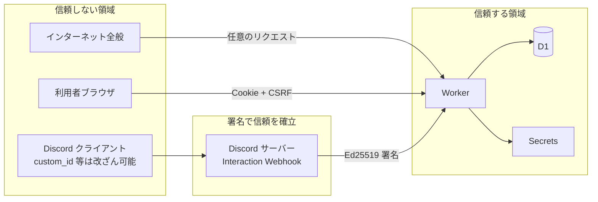
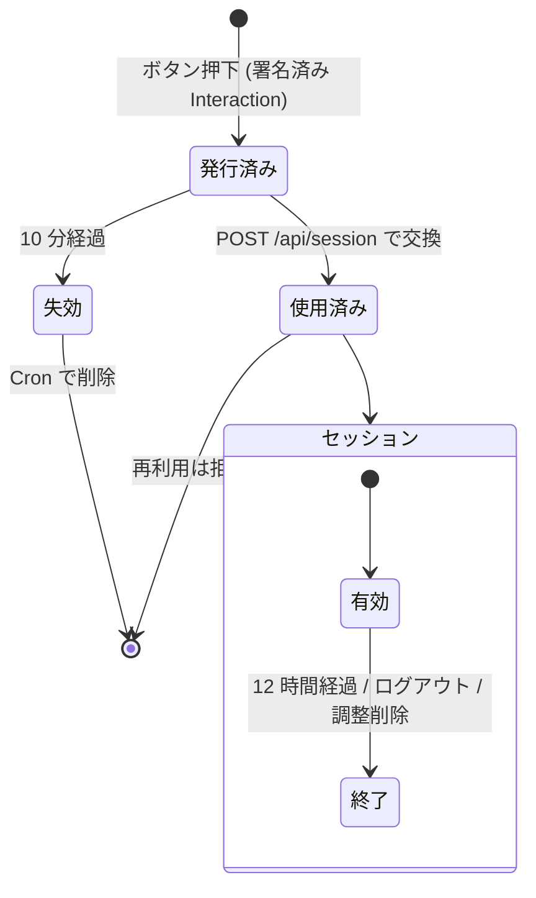

# DIscheduler セキュリティ設計書

本書は DIscheduler のセキュリティ設計の詳細（脅威モデル・対策・検証方法）を記述する。
**本書はリポジトリとともに公開し、Web 画面の `/security` からも参照できるようにする。**
利用者向けの要約は [SECURITY.md](../SECURITY.md) を参照。

- 版: 0.2
- 作成日: 2026-11-04
- 改訂: 2026-11-05（保持期間 6 ヶ月、回答の公開範囲、作成権限、タイムゾーン保存方法を反映）

> 公開方針: 「仕組みを隠すことで守る」設計は採らない。本書の内容がすべて公開されても安全であることを前提に設計する（ケルクホフスの原理）。秘密にするのは鍵・トークンのみ。

---

## 1. 保護対象（資産）

| 資産 | 内容 | 重要度 |
|------|------|--------|
| A1 Bot トークン | Discord Bot として API を操作できる資格情報 | 最高 |
| A2 Discord 公開鍵 | 署名検証に使用（公開情報だが改ざん防止が必要） | 高 |
| A3 Cloudflare API トークン | デプロイ用 | 最高 |
| A4 参加者の予定回答 | 誰がいつ空いているか（生活パターンの推測につながる） | 高 |
| A5 参加者リスト | Discord ユーザー ID・表示名・どのサーバー/ロールに属するか | 中 |
| A6 セッション・入力リンク | 他人になりすまして回答できる | 高 |
| A7 サービス可用性 | 無料枠を枯渇させられると利用不能 | 中 |

## 2. 信頼境界



- Worker に届くリクエストは **すべて敵対的** として扱い、署名・セッション・入力検証を通過したもののみ処理する。
- Discord から届く Interaction でも、`custom_id`・モーダル入力値はユーザーが改ざんできるため検証対象とする。信頼するのは署名済み本文中の `user.id` / `member` / `guild_id` / `channel_id` のみ。

---

## 3. 脅威モデル（STRIDE）と対策

### 3.1 なりすまし（Spoofing）

| ID | 脅威 | 対策 |
|----|------|------|
| S-1 | 第三者が `/discord/interactions` に偽の Interaction を送り、他人として操作 | **Ed25519 署名検証**（`X-Signature-Ed25519` / `X-Signature-Timestamp`）を Web Crypto で実施。検証前に本文をパースしない。失敗時は 401。タイムスタンプが ±5 分を超えたら拒否（リプレイ対策） |
| S-2 | 入力リンクの横取り・推測による他人の回答改ざん | トークンは CSPRNG（`crypto.getRandomValues`）で 256bit 生成。**ephemeral メッセージ**で本人にのみ表示。**10 分で失効・1 回限り**。DB には SHA-256 ハッシュのみ保存。URL フラグメントに置きサーバーログ・Referer に残さない |
| S-3 | セッション Cookie の窃取 | `__Host-sid; Secure; HttpOnly; SameSite=Strict; Path=/`。有効期限 12 時間・延長なし。**1 調整にスコープ**し、窃取時の影響を当該調整に限定。DB にはハッシュのみ保存 |
| S-4 | 主催者になりすまして確定・削除 | 主催者権限はセッション発行時に `polls.organizer_id` と Interaction の `user.id` の一致で付与。API ごとに `role = organizer` を再確認 |
| S-5 | 偽の DIscheduler サイトへの誘導（フィッシング） | 公式ドメインを README・`/schedule help`・`/security` に明記。本アプリは **Discord のパスワードや OAuth 同意を一切求めない** ことを周知 |

### 3.2 改ざん（Tampering）

| ID | 脅威 | 対策 |
|----|------|------|
| T-1 | SQL インジェクション | D1 の **プリペアドステートメント（`prepare().bind()`）のみ使用**。文字列連結での SQL 組み立てを ESLint ルールで禁止 |
| T-2 | 他人の回答・他の調整のデータを書き換え（IDOR） | 回答 API はパスに `me` を使い、ユーザー ID は **セッションからのみ** 取得。`poll_id` もセッションのスコープと一致必須。slotId が当該調整に属するか検証 |
| T-3 | CSRF による意図しない操作 | `SameSite=Strict` Cookie ＋ **CSRF トークン（ヘッダー `X-CSRF-Token`）** ＋ `Origin` ヘッダーの完全一致検証 ＋ `Content-Type: application/json` 必須 |
| T-4 | `custom_id` 改ざんによる他調整への操作 | `custom_id` の pollId で調整を引き、Interaction の `guild_id`/`channel_id` と調整の値が一致することを検証 |
| T-5 | 配信する JS/CSS の改ざん | すべて同一オリジンから配信（外部 CDN 不使用）。CSP で外部スクリプトを禁止。ビルドは CI 上でのみ行いデプロイ |

### 3.3 否認（Repudiation）

| ID | 脅威 | 対策 |
|----|------|------|
| R-1 | 「確定した覚えはない」等の紛争 | 確定・削除・候補変更・リマインドなど主催者操作を、ユーザー ID・時刻・操作種別のみで構造化ログ出力（内容・IP は記録しない）。回答には `answered_at` を記録 |

### 3.4 情報漏えい（Information Disclosure）

| ID | 脅威 | 対策 |
|----|------|------|
| I-1 | 参加者以外が回答状況を閲覧 | 閲覧 API はセッション必須。セッションは参加者（または主催者）にのみ発行。個人別の回答は **その調整の参加者全員に公開する仕様** だが、参加者以外には返さない。チャンネルの募集メッセージには **集計人数のみ** 表示する。回答画面に「参加者全員に表示されます」と明記する |
| I-2 | 調整 ID の推測による列挙 | ID は 128bit ランダム。ただし **ID を知っていてもセッションがなければ何も見えない**（ID を秘密情報として扱わない設計） |
| I-3 | XSS による情報窃取 | 後述 §4.2 の CSP、DOM への挿入は `textContent` のみ（`innerHTML` 禁止を ESLint で強制）、Trusted Types を有効化 |
| I-4 | ログ・エラーからの漏えい | ログに個人情報・トークン・Cookie を出力しない（ロガーで既知キーをマスク）。エラー応答は汎用メッセージと相関 ID のみ。スタックトレースを返さない |
| I-5 | Bot トークン等の漏えい | Cloudflare の **Secrets**（`wrangler secret put`）で管理し、リポジトリ・`wrangler.toml`・CI ログに含めない。GitHub の Secret scanning / Push protection を有効化。漏えい時の手順は §7 |
| I-6 | 過剰なデータ収集 | Message Content Intent・OAuth・メール・IP・アバターを扱わない（設計書 §7.3）。保持期間後は物理削除（設計書 §7.4） |
| I-7 | Referer による URL 漏えい | `Referrer-Policy: no-referrer`。トークンは URL フラグメントに置き、読み取り後 `history.replaceState` で消去 |
| I-8 | 検索エンジンへの掲載 | `X-Robots-Tag: noindex, nofollow` と `robots.txt` で `/security` 以外をクロール拒否 |
| I-9 | 閲覧者のタイムゾーン設定からの情報収集 | 表示タイムゾーンの選択値はブラウザの localStorage にのみ保存し、サーバーには送らない・保存しない。調整のタイムゾーン（主催者が設定）のみ保存する |

### 3.5 サービス拒否（Denial of Service）

| ID | 脅威 | 対策 |
|----|------|------|
| D-1 | 大量リクエストで無料枠を枯渇 | Cloudflare の DDoS 保護（無料で自動適用）。署名検証・セッション検証を最初に行い、失敗リクエストは D1 にアクセスせず即時拒否。Cloudflare WAF レート制限ルール（無料枠 1 ルール）を `/api/*` に設定 |
| D-2 | 正規ユーザーによる大量操作 | アプリ内レート制限（D1 カウンタ）: 調整作成 10 件/時/ユーザー、回答保存 30 回/10 分/ユーザー、リマインド 1 回/12 時間/調整、入力リンク発行 20 回/時/ユーザー |
| D-3 | 巨大入力による CPU/ストレージ消費 | リクエストボディ上限 32KB。候補 30 件・参加者 100 名・タイトル 100 字・コメント 100 字などの上限をスキーマと DB の `CHECK` 制約の二重で強制 |
| D-4 | Discord API レート制限による機能停止 | REST クライアントで `X-RateLimit-*` を尊重し、429 時は `retry_after` に従う。募集メッセージ更新はデバウンス |

### 3.6 権限昇格（Elevation of Privilege）

| ID | 脅威 | 対策 |
|----|------|------|
| E-1 | Bot の過剰権限を悪用される | **Administrator を要求しない**。必要最小限の権限のみ（設計書 §5.2）。Bot ができることは「投稿・自分の投稿の編集・イベント作成」に限定 |
| E-2 | 参加者が主催者操作を実行 | すべての主催者 API でサーバー側の認可チェック。UI 上のボタン非表示はあくまで補助 |
| E-3 | Bot を利用したメンションスパム | 投稿時は `allowed_mentions` を明示し、`@everyone`/`@here`/ロールメンションを **常に無効化**。ユーザーメンションは参加者 ID のみ許可。ユーザー入力（タイトル等）に含まれるメンション記法は無効化される |
| E-4 | 依存パッケージ経由の侵害（サプライチェーン） | §5 参照 |

---

## 4. 実装上の対策詳細

### 4.1 Interaction 署名検証（擬似コード）

```ts
async function verifyDiscordRequest(req: Request, publicKeyHex: string) {
  const sig = req.headers.get("X-Signature-Ed25519");
  const ts = req.headers.get("X-Signature-Timestamp");
  if (!sig || !ts || !/^[0-9a-f]{128}$/.test(sig) || !/^\d{1,12}$/.test(ts)) return null;
  if (Math.abs(Date.now() / 1000 - Number(ts)) > 300) return null; // リプレイ対策

  const body = await req.text(); // 生のバイト列で検証（パース前）
  const key = await crypto.subtle.importKey(
    "raw", hexToBytes(publicKeyHex), { name: "Ed25519" }, false, ["verify"]);
  const ok = await crypto.subtle.verify(
    "Ed25519", key, hexToBytes(sig), new TextEncoder().encode(ts + body));
  return ok ? body : null;
}
```

- Discord は不正署名リクエストを定期的に送って検証の有無を確認するため、検証漏れはエンドポイント登録自体ができない。

### 4.2 HTTP セキュリティヘッダー（全レスポンス）

```
Content-Security-Policy: default-src 'none'; script-src 'self'; style-src 'self';
  img-src 'self' data:; connect-src 'self'; font-src 'self'; form-action 'self';
  frame-ancestors 'none'; base-uri 'none'; require-trusted-types-for 'script';
  upgrade-insecure-requests
Strict-Transport-Security: max-age=63072000; includeSubDomains; preload
X-Content-Type-Options: nosniff
X-Frame-Options: DENY
Referrer-Policy: no-referrer
Permissions-Policy: camera=(), microphone=(), geolocation=(), payment=(), usb=(), interest-cohort=()
Cross-Origin-Opener-Policy: same-origin
Cross-Origin-Resource-Policy: same-origin
Cache-Control: no-store            （API・HTML。ハッシュ付き静的アセットは immutable）
X-Robots-Tag: noindex, nofollow    （/security を除く）
```

- `'unsafe-inline'` / `'unsafe-eval'` は使用しない。インラインスクリプト・インラインスタイル・`eval` を禁止。
- 設定値はテストで固定化し、緩める変更は CI で検知する。

### 4.3 トークンとセッションのライフサイクル



- トークン交換は `UPDATE link_tokens SET used_at=? WHERE token_hash=? AND used_at IS NULL AND expires_at>?` の 1 文で行い、**競合時の二重使用を防ぐ**（変更行数 1 のときのみ成功）。
- 比較は DB のハッシュ一致で行うためタイミング攻撃の影響を受けない。CSRF トークン比較は定数時間比較を使用。
- セッション発行時に参加者であることを再確認。主催者が参加者から外した場合、既存セッションも即時削除。

### 4.4 入力検証と出力エンコード

| 箇所 | 方針 |
|------|------|
| API 入力 | Valibot スキーマで型・長さ・範囲・形式を検証。未知キー拒否。日時は UNIX 秒の整数で受け取り、過去 1 日〜未来 1 年の範囲に限定 |
| Discord 入力 | モーダル・コマンドオプションも同じスキーマで検証 |
| Web 出力 | `textContent` / `setAttribute`（URL 属性以外）のみ。`innerHTML`・`document.write`・`eval` は ESLint（`no-unsanitized`）で禁止 |
| Discord 出力 | ユーザー入力をメッセージに含めるときは Markdown 記法とメンション記法をエスケープし、`allowed_mentions` で制御 |
| 表示名 | Discord から取得した表示名も信頼せず、制御文字・双方向制御文字（U+202E 等）を除去し 64 文字に切り詰め |

### 4.5 シークレット管理

| シークレット | 保管場所 | ローテーション |
|-------------|----------|----------------|
| `DISCORD_BOT_TOKEN` | Cloudflare Secrets | 年 1 回および漏えい疑い時に即時 |
| `DISCORD_PUBLIC_KEY` | Cloudflare 環境変数（公開値） | アプリ再作成時 |
| `DISCORD_APPLICATION_ID` | Cloudflare 環境変数（公開値） | — |
| `CLOUDFLARE_API_TOKEN` | GitHub Actions Environment Secret（`production` 環境・承認必須） | 年 1 回。権限は対象 Worker / D1 の編集のみに限定 |

- ローカル開発は `.dev.vars`（`.gitignore` 済み）を使い、本番とは別の Discord アプリ・別の D1 を使用する。

---

## 5. サプライチェーン・開発プロセス

| 対策 | 内容 |
|------|------|
| 依存最小化 | ランタイム依存は Hono・Valibot のみ。追加は PR でレビュー必須（理由・メンテ状況・権限を記載） |
| ロックファイル | `package-lock.json` をコミットし、CI は `npm ci` のみ使用。`--ignore-scripts` でインストールスクリプトを無効化 |
| 脆弱性監視 | Dependabot（セキュリティアップデート＋週次バージョン更新）、CI で `npm audit --audit-level=high` |
| 静的解析 | GitHub CodeQL、ESLint（セキュリティルール）、TypeScript `strict` |
| GitHub Actions | サードパーティ Action は **コミット SHA で固定**。`permissions:` を最小化（既定 `contents: read`） |
| ブランチ保護 | `main` への直接 push 禁止、PR レビュー必須、CI 成功必須 |
| デプロイ | `main` マージ時のみ GitHub Actions からデプロイ。手動承認付きの `production` Environment を使用 |
| シークレット検出 | GitHub Secret scanning ＋ Push protection |

---

## 6. テスト・検証

| 種別 | 内容 |
|------|------|
| 単体テスト | 署名検証（正常・改ざん・期限切れ・形式不正）、権限計算、スキーマ境界値 |
| 結合テスト | `@cloudflare/vitest-pool-workers` で D1 を含めて実行。IDOR（他人・他調整の操作）、CSRF 欠如、トークン再利用、期限切れ、主催者以外の確定などの **否定系テストを必須** とする |
| ヘッダーテスト | 全ルートで §4.2 のヘッダーが付与されることを検査 |
| 依存監査 | CI で毎回実行 |
| 手動レビュー | リリース前に本書のチェックリスト（§8）を確認 |

---

## 7. インシデント対応

1. **検知**: 脆弱性報告（SECURITY.md の窓口）、Cloudflare/Discord からの通知、異常なリクエスト量
2. **封じ込め**
   - Bot トークン漏えい疑い → Developer Portal で即時 Reset Token → Cloudflare Secret 更新
   - Web 側の脆弱性 → 環境変数 `MAINTENANCE=1` で Web API を停止（Discord 側は「メンテナンス中」応答）
   - 全セッション失効: `DELETE FROM sessions; DELETE FROM link_tokens;`
3. **根絶・復旧**: 修正 → テスト → デプロイ
4. **報告**: 影響範囲・原因・対策を GitHub Security Advisory として公開。影響サーバーには Discord 上で告知

---

## 8. リリース前チェックリスト

- [ ] 署名検証が全 Interaction で先頭に実行される
- [ ] 全 API に認証・認可・CSRF・Origin 検証がある（公開エンドポイント以外）
- [ ] 全 SQL がプリペアドステートメント
- [ ] `innerHTML` 等の危険な DOM API が使われていない（ESLint 通過）
- [ ] セキュリティヘッダーテストが通過
- [ ] `allowed_mentions` が全投稿で明示されている
- [ ] ログに個人情報・トークンが出ていない
- [ ] シークレットがリポジトリに含まれていない（Secret scanning 通過）
- [ ] `npm audit` に High 以上がない
- [ ] Bot 招待 URL の権限が設計書 §5.2 と一致
- [ ] データ自動削除 Cron が動作する

---

## 9. 既知の制約・残存リスク（正直な開示）

| 項目 | 内容 | 判断 |
|------|------|------|
| Server Members Intent | 標準の自動抽出（`auto`）のためにギルドメンバー一覧（ID・表示名・ロール）を取得する。取得したうち参加者以外の情報は保存しない | 特権インテントを避けたいサーバーは、調整ごとに手動選択（`manual`）を選ぶか、Developer Portal で Intent を無効にすれば自動的に手動選択で動作する |
| 回答の参加者間公開 | 個人ごとの ○△× は同じ調整の参加者全員が閲覧できる | 日程調整の利便性のための仕様。参加者以外には公開しない |
| 保持期間 6 ヶ月 | 締切／確定から 6 ヶ月間は予定データが残る | 振り返り・再調整の利便性のための判断。主催者はいつでも即時削除できる |
| 作成権限 | コマンドを実行できる人は誰でも調整を作成できる | 作成数のレート制限で乱用を抑止。必要ならサーバー管理者が Discord 標準設定で制限可能 |
| 入力リンクの転送 | ephemeral メッセージのリンクを本人が他人に渡すと、10 分以内・1 回に限り本人として回答できる | 本人の意思による委任と同等とみなす。1 回限り・短命で影響を限定 |
| Cloudflare / Discord への依存 | 両社のインフラ・従業員はデータにアクセスしうる | 各社のセキュリティ・プライバシーポリシーに依拠。保存データを最小化して影響を低減 |
| 無料プラン | SLA なし、Workers のログ保持が短い | 用途（日程調整）に対して許容 |
| D1 の保存時暗号化 | Cloudflare 側で保存時暗号化されるが、アプリ側での追加暗号化は行わない | 保存データが予定と表示名のみであり、鍵管理の複雑化による事故リスクの方が大きいと判断 |
